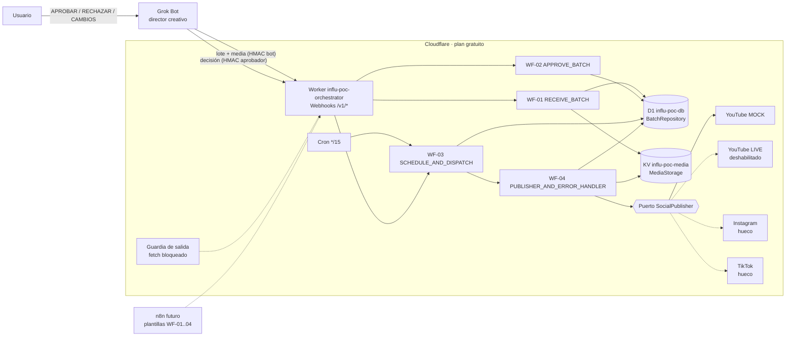

# Arquitectura (Fase 1)

Arquitectura hexagonal (puertos y adaptadores). El núcleo no conoce ninguna red social ni tecnología de almacenamiento.

| Capa (especificación) | Dónde vive | Notas |
|---|---|---|
| A. Producción creativa | Grok Bot → `content/batches/LOTE-XXXX/` | Conceptos, guiones, prompts, imágenes IA, vídeos ffmpeg, copies, hashtags. Formato de lote independiente de la publicación. |
| B. Gestión de contenidos | `src/workflows/wf01-receive-batch.js`, `src/core/domain/*`, puerto `BatchRepository` (D1), puerto `MediaStorage` (KV) | Validación, versiones, huella SHA-256, registro. |
| C. Aprobación | `src/workflows/wf02-approve-batch.js` | Decisión explícita con clave de aprobador, ligada a versión + huella. |
| D. Publicación | `src/workflows/wf03-schedule-dispatch.js`, `wf04-publisher.js` | Despacho periódico, anti-duplicados, reintentos limitados, informes. |
| E. Integración con redes | `src/adapters/publishers/*` detrás del puerto `SocialPublisher` | YouTube MOCK implementado; YouTube LIVE stub deshabilitado; Instagram/TikTok huecos. |

## Diagrama de componentes

## Decisiones

- **Workers + D1 en lugar de n8n Cloud + Data Tables**: n8n Cloud no está autorizado. Los workflows WF-01..04 se implementan como código en el Worker; las plantillas n8n (`n8n/workflows`) llaman a la misma API, así que n8n puede ponerse delante más tarde sin tocar núcleo, lotes ni aprobación.
- **KV + índice D1 en lugar de R2**: R2 exige activarse en el panel de Cloudflare (la API respondió «Please enable R2 through the Cloudflare Dashboard»). KV es eventualmente consistente, por eso la existencia de archivos se consulta en D1. Cambiar a R2 = nuevo adaptador `R2MediaStorage` con el mismo contrato.
- **Un solo Worker** con módulos separados por capa: menos piezas; la separación se mantiene en el código (cada adaptador es un módulo detrás de un puerto).
- **Simulador con estado en D1** (tabla `mock_provider_records`, separada de las tablas del sistema) para consultar estados y detectar duplicados con consistencia fuerte.
- **Seguridad desde el diseño**: HMAC-SHA256 + marca de tiempo + nonce anti-replay; claves distintas para bot y aprobador; secretos como Secrets de Workers; guardia de salida que bloquea cualquier `fetch()` en modo MOCK; LIVE deshabilitado en la build.
