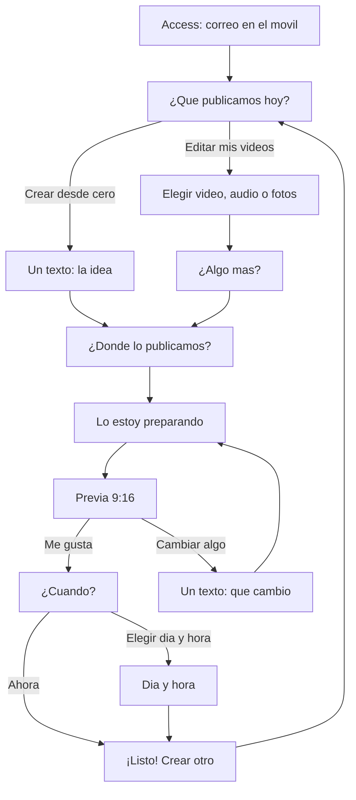
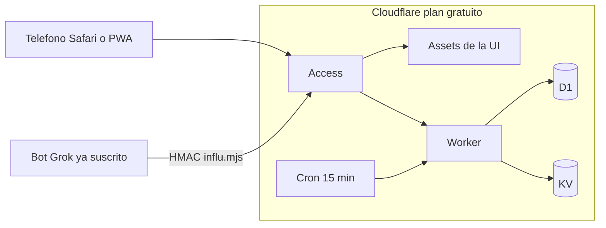

# Plan: UI de encargos (análisis, sin código de producto)

Fecha de las fuentes: 18 de noviembre de 2026. Base del repo: `main` en `db9109d` (incluye `AGENTS.md` y la skill de shadcn). Este documento no cambia el Worker, el bot ni el modo de publicación.

El producto sigue en **MOCK**. `LIVE_ENABLED_IN_BUILD` permanece en `false`. Nada de lo que se apruebe en la UI sale a YouTube, Instagram o TikTok.

El único coste aceptado es la suscripción de Grok que ya existe, usada por el bot que genera la pieza. Infraestructura, almacenamiento, alojamiento, autenticación, APIs de plataforma y librerías se quedan en planes gratuitos. Si una pieza no cabe en un plan gratuito, queda como riesgo o como decisión abierta, con una alternativa que no pide pago. No se asume una tarjeta ni un plan de pago.

## Resumen

La persona dueña de la cuenta sustituye al influencer virtual. Entra en una web de una sola columna, pensada para el móvil y usable con una mano. Cada pantalla hace una sola pregunta. El hilo es el de la referencia:

1. «¿Qué publicamos hoy?» — Crear desde cero, o editar vídeo, audio, imágenes o texto que ya tiene.
2. «Mira lo que he preparado» — previa vertical 9:16, y solo «¡Me gusta!» o «Cambiar algo».
3. «¡Listo!» — a qué plataformas va (en simulación), la racha de días y «Crear otro».

Entre esas tres hay pantallas igual de cortas para el material, las plataformas y el momento de publicar. Publicar de inmediato o programar fecha y hora ocurre **después** de aprobar. Hoy `scheduled_at` forma parte de la huella y hay que decidirlo antes de aprobar; eso cambia (apartado de API).

La UI vive en el mismo Worker, como assets estáticos, detrás del Cloudflare Access que ya protege la API. El navegador no guarda secretos HMAC. El encargo se escribe en D1. El bot Grok que ya genera con Grok Imagine lo recoge con `bot/influ.mjs`, produce la pieza y la devuelve por el mismo CLI. El Worker no llama a Grok: la guardia de salida en MOCK no deja salir a Internet, y una llamada desde el Worker sería otro contrato de pago.

El vídeo se queda en KV. R2 no se activa: el alta pide un método de pago y lo que pase del cupo gratuito se factura. Un archivo mayor de 25 MiB se parte en trozos reanudables; el Worker no los junta. El bot los lee y monta la pieza. Lo que no quepa en el cupo gratuito se rechaza con un mensaje claro.

Varias personas usan la misma UI. Cada una solo ve sus encargos. El aislamiento sale del correo del JWT de Access, no de un usuario escrito a mano.

## Coste cero

| Pieza | Plan | Límite gratuito (fuente) | Al superarlo |
|---|---|---|---|
| Worker (API) | Workers Free | 100.000 peticiones/día; 10 ms de CPU por invocación HTTP y por cron; 128 MB de memoria; 50 subpeticiones externas y 1.000 a servicios de Cloudflare por invocación; 5 cron por cuenta. [Límites](https://developers.cloudflare.com/workers/platform/limits/), [precios](https://developers.cloudflare.com/workers/platform/pricing/), [subpeticiones](https://developers.cloudflare.com/changelog/post/2026-02-11-subrequests-limit/) | Peticiones: error 1027 hasta las 00:00 UTC. CPU: error 1102, la invocación se corta. No hay cargo en el plan Free: la petición falla. |
| Assets de la UI | Incluidos en Workers | Las peticiones a assets estáticos son gratis y no tienen tope. Cada asset ≤ 25 MiB; 20.000 archivos por versión en Free. [Precios](https://developers.cloudflare.com/workers/platform/pricing/), [límites](https://developers.cloudflare.com/workers/platform/limits/) | Un asset demasiado grande no se despliega. El HTML, el JS y los iconos de la PWA caben de sobra. |
| Cuerpo HTTP | Zona Free, Worker en un dominio propio | 100 MB por petición; por encima, HTTP 413. [Límites](https://developers.cloudflare.com/workers/platform/limits/) | La POC está en `workers.dev`, no en un dominio propio. El diseño no depende de esos 100 MB: cada trozo mide 4 MB. |
| KV `influ-poc-media` | Incluido en Workers Free | 25 MiB por valor; 1 GB por cuenta y por namespace; 100.000 lecturas/día; 1.000 escrituras, 1.000 borrados y 1.000 listados/día; 1 escritura/segundo a la misma clave. El cupo diario se reinicia a las 00:00 UTC. [Límites](https://developers.cloudflare.com/kv/platform/limits/), [precios](https://developers.cloudflare.com/kv/platform/pricing/) | Esa operación falla. Los datos ya guardados siguen. No hay cargo en Free. |
| D1 `influ-poc-db` | Workers Free | 5 millones de filas leídas/día; 100.000 filas escritas/día; 5 GB en la cuenta; 500 MB por base; 10 bases; 50 consultas por invocación; fila o BLOB ≤ 2 MB. Desde el 1 de septiembre de 2026 el cupo diario se aplica de verdad. [Precios](https://developers.cloudflare.com/d1/platform/pricing/), [límites](https://developers.cloudflare.com/d1/platform/limits/), [aviso](https://developers.cloudflare.com/changelog/post/2026-09-01-d1-free-tier-limit-enforcement/) | Las consultas fallan hasta las 00:00 UTC. Si se llena el disco, hay que borrar datos antes de insertar. No hay cargo en Free. |
| Cron actual | 1 de los 5 del plan Free | `*/15` ya está en `wrangler.toml`. CPU de cron en Free: 10 ms. Pared: 15 min. | Un segundo cron de generación no cabe en el diseño: el Worker no genera, y otro cron gastaría uno de los 5. |
| Access (login de la UI) | Zero Trust Free | 50 usuarios. El bot entra con service token y no consume asiento. [Planes](https://www.cloudflare.com/plans/zero-trust-services/), [asientos](https://developers.cloudflare.com/cloudflare-one/team-and-resources/users/seat-management/) | Quien llegue sin asiento libre no entra. Hay que liberar un asiento. El alta del plan Free pide datos de pago y dice que no cobra ([alta](https://developers.cloudflare.com/learning-paths/clientless-access/initial-setup/create-zero-trust-org/)). Esta cuenta ya tiene Access (`ACCESS_TEAM_DOMAIN` en `wrangler.toml`): no hace falta otro alta. |
| Workers Logs | Free hasta el 30 de noviembre de 2026; Observability Free desde el 1 de diciembre de 2026 | Hasta entonces: 200.000 eventos/día, retención 3 días. Después: 0,5 GB de ingesta/día; al llegar, la ingesta se detiene y no se factura. [Logs](https://developers.cloudflare.com/workers/observability/logs/workers-logs/), [Observability](https://developers.cloudflare.com/observability/pricing/) | Se dejan de guardar logs nuevos. El Worker sigue. `[observability] enabled = true` puede quedarse. |
| R2 | Tiene cupo mensual gratis (10 GB, 1 millón de operaciones de clase A, 10 millones de clase B) y la salida a Internet no se cobra. [Precios](https://developers.cloudflare.com/r2/pricing/) | Activarlo exige completar el alta de la suscripción. [Primeros pasos](https://developers.cloudflare.com/r2/get-started/). Lo que pase del cupo se factura. | **No se activa.** Ver riesgos. |
| shadcn/ui, React, Tailwind | Código que el CLI copia al repo | Sin cuenta ni plan. `components.json` no existe; lo crea `npx shadcn@latest init` el día que la UI entre en el producto. Hasta entonces no se crea: lo dice `AGENTS.md`. La skill está en `.agents/skills/shadcn` y el MCP en `.cursor/mcp.json`. | Nada que pagar. |
| PWA | Función del sistema | Manifiesto web y «Añadir a pantalla de inicio». [Apple](https://support.apple.com/guide/iphone/open-as-web-app-iphea86e5236/ios), [WebKit](https://webkit.org/blog/13878/web-push-for-web-apps-on-ios-and-ipados/) | Sin tienda y sin cuota. |
| YouTube, Instagram, TikTok | APIs con cupo gratuito de plataforma | No se usan en el MVP. El diseño futuro está más abajo. El cupo por defecto no lleva un precio publicado en las páginas citadas; subir de cupo o pasar una auditoría no se presupuesta como gasto. | Fuera del MVP. |
| Grok / Grok Imagine | Suscripción que ya tienes | El bot actual genera imagen y vídeo y llama a `bot/influ.mjs`. | El Worker no añade una clave de API de Grok. |

La UI no sondea el vídeo. Sondea un JSON de estado, como mucho cada 15 s, y solo mientras la pantalla de espera está visible (`document.visibilityState`). Cincuenta personas con la espera abierta ocho horas a ese ritmo se acercan a las 100.000 peticiones/día. Con el uso real de un grupo pequeño queda muy por debajo. Los assets no cuentan.

## Flujo de UX

Una columna, la misma en el teléfono y en el escritorio (en pantalla ancha queda centrada, con un ancho de lectura). La acción principal está abajo, en la zona del pulgar, con al menos 44×44 pt y aire alrededor. Ese es el tamaño por defecto de control en iOS. [Accesibilidad](https://developer.apple.com/design/human-interface-guidelines/accessibility), [controles](https://developer.apple.com/design/tips/). El contenido respeta las zonas seguras (el hueco de la isla y la barra de inicio). [Layout](https://developer.apple.com/design/human-interface-guidelines/layout).

No hay menú, ni barra de iconos, ni ajustes en el camino. «Atrás» del sistema basta para salir. Cada pantalla tiene un verbo.

### Pantallas

**0. Entrar.** La hace Cloudflare Access, a página completa, antes de la UI. En el teléfono es el mismo Safari, con las cookies permitidas. El método es el que ya tenga el equipo de Access (el alta permite un PIN de un solo uso enviado por Cloudflare, sin otro proveedor de correo). La UI no tiene formulario de alta.

**1. «¿Qué publicamos hoy?»** Arriba, una línea con la racha («3 días seguidos») y otra, pequeña: «Simulación: todavía no se publica de verdad». Abajo, dos botones de ancho completo: «Crear desde cero» y «Editar mis vídeos». Si en el futuro una persona tiene varias cuentas de creador, delante va una pantalla «¿Con qué cuenta?», un botón por cuenta. En el MVP propuesto hay una cuenta por persona y esa pantalla no sale.

**2a. Desde cero.** Un solo campo: «Cuéntame la idea». El teclado del teléfono sube el botón «Prepararlo», que sigue visible. El campo puede ser largo; la decisión es una.

**2b. Editar.** Un botón: «Elegir vídeo, audio o fotos». Abre el selector del sistema (`<input type="file" accept="image/*,video/*,audio/*" multiple>` sin `capture`, para que iOS ofrezca cámara, galería y archivos en la misma hoja). [Estado de subida de archivo](https://html.spec.whatwg.org/multipage/input.html#file-upload-state-(type=file)). Lo elegido se ve al momento con un `object URL` local, en vertical si es vídeo, sin esperar a la red. «Seguir» es el único botón de avance. «Elegir otro» sustituye la selección y vuelve a abrir la hoja.

**2c. «¿Algo más?»** Un campo de texto que puede quedar vacío, y «Prepararlo». Sirve para la nota que acompaña al material («quita el principio», «usa esta frase»).

**3. «¿Dónde lo publicamos?»** Una lista de plataformas con adaptador que de verdad valida en MOCK. Hoy solo YouTube: Instagram y TikTok están registrados y su adaptador responde `NOT_IMPLEMENTED`, así que un lote con esas plataformas se queda en `DRAFT` y no llega a revisión. Hasta que existan sus simuladores, la lista muestra YouTube. Cada fila es un control grande. Un botón: «Seguir».

**4. «Lo estoy preparando.»** Sin decisión. Una frase y una barra. Se puede cerrar el teléfono. Al volver, la misma URL abre este encargo. Si el bot no ha podido recogerlo, el texto lo dice y no hay otro botón que pulsar.

**5. «Mira lo que he preparado.»** El vídeo ocupa el hueco que dejan los botones, relación 9:16, `playsinline` para que iOS no lo mande a pantalla completa ([`playsinline`](https://developer.mozilla.org/en-US/docs/Web/HTML/Reference/Elements/video#playsinline)). Empieza en silencio. Tocar el vídeo es el único gesto de sonido. Abajo, «¡Me gusta!» y «Cambiar algo», los dos por encima de la zona segura, los dos de al menos 44 pt. Una línea: «Hecho con ayuda de IA» cuando la pieza la ha generado el bot.

**6. «¿Qué cambio?»** Un campo y «Volver a preparar». Eso pide una versión nueva. La aprobación anterior, si la hubo, queda invalidada, como ya hace WF-01.

**7. «¿Cuándo?»** Solo tras «¡Me gusta!». «Ahora» o «Elegir día y hora».

**8. Día y hora.** El control nativo del teléfono (`datetime-local`), que en iOS es la rueda del sistema, y «Programar».

**9. «¡Listo! Se publica …»** En simulación. Lista las plataformas, la hora («ahora» o la elegida), la racha del día y «Crear otro», que vuelve a la pantalla 1. Debajo, una línea, no un botón: cómo añadir el icono a la pantalla de inicio.

Estados vacíos y de error ocupan la misma columna y un solo botón: «Reintentar» o «Elegir otro». Un archivo que no cabe dice el motivo en una frase («Este vídeo pasa de lo que puedo guardar. Prueba con uno más corto.») y no ofrece un plan de pago.

## Móvil, subidas, Safari y PWA

### Cámara y galería

El selector del sistema es la vía del MVP. En iPhone, un input de archivo sin `capture` deja que la persona grabe en el momento o elija de la galería. Un `capture` fijo abriría solo la cámara y escondería la galería; por eso no se pone en el botón único.

La previa de lo elegido es local. La previa de «lo que he preparado» es el archivo que devuelve el bot, un vertical corto, una sola lectura de KV.

El audio entra como material de origen (`audio/*`). Hoy `PUT /v1/media` solo acepta `video/*` e `image/*`. El audio no es una publicación: el lote publicado sigue siendo la pieza que arma el bot. El texto vive en D1 (el tope de fila es 2 MB; un encargo de texto no se acerca).

### Subidas grandes y reanudables, dentro del cupo gratis

El código corta cada cuerpo en 20 MB (`MAX_MEDIA_BYTES` en `src/worker.js`). KV no acepta un valor de más de 25 MiB. El Worker tiene 128 MB de memoria y 10 ms de CPU: no puede transcodificar, ni calcular el SHA-256 de un vídeo largo, ni juntar trozos. Eso se mide en la fase de subida; si un trozo de 4 MB no cabe en 10 ms, el trozo se baja. No se afirma aquí que quepa.

Diseño:

1. Archivo que cabe en un solo `PUT` (≤ 20 MB, por debajo de 25 MiB): una escritura KV, como ahora. Es el caso del ejemplo del repo (8 s, 720×1280).
2. Archivo mayor: el teléfono lo parte con `File.slice` (no carga el archivo entero en memoria). Cada trozo mide 4 MB, muy por debajo del valor de KV y del 413 de una zona Free.
3. D1 guarda la sesión: qué trozos han llegado, tipo, tamaño, cuenta dueña. Cada trozo es una clave KV `upload/<id>/<n>` y cuenta como una escritura.
4. Si iOS mata la pestaña, el `File` desaparece. Al volver, la persona elige **el mismo** archivo y el cliente salta los trozos ya guardados. El texto de la pantalla lo dice. `localStorage` recuerda el id de la sesión en ese origen.
5. El Worker no concatena. El bot, fuera del Worker, lee los trozos en orden y monta el archivo antes de generar. La pieza resultante vuelve a entrar por el `PUT` de siempre, en un solo archivo ≤ 20 MB.
6. Techo propuesto, a confirmar: 80 MB por archivo de origen (20 escrituras) y una subida grande activa por persona. Ochenta megabytes por diez archivos llenan buena parte del gigabyte de KV; por eso el material de origen se borra cuando el bot ya ha entregado la pieza. Mil escrituras al día dan para muchas piezas cortas y para unas decenas de archivos partidos.

No hay compresión con ffmpeg en el teléfono: en un iPhone se come la memoria y no es un camino fiable. Si el archivo pasa del techo, se rechaza.

### Una mano y 9:16

- Columna única. Botón principal abajo, ancho completo, `padding-bottom: env(safe-area-inset-bottom)`.
- `min-height: 44px` en todo control, con separación para no pulsar el vecino. En shadcn, `Button` a bloque y `ToggleGroup` en vertical para las dos opciones de una pantalla.
- Altura con `dvh`, no `100vh`, para que la barra de Safari no tape el botón.
- El teclado no esconde el botón de enviar: el campo y el botón caben en la zona visible, o la página se desplaza hasta el botón.
- La previa 9:16 encoge antes de tapar los dos botones. En un teléfono bajo, se ve el vídeo y se llega a «¡Me gusta!» sin scroll horizontal.
- No hay objetivo pequeño en una esquina superior.

### iOS Safari y Access

La UI y la API comparten origen (el mismo Worker). Así `CF_Authorization` es una cookie de primera parte. Access la pone en el dominio de la aplicación tras el login. [Cookie de autorización](https://developers.cloudflare.com/cloudflare-one/access-controls/applications/http-apps/authorization-cookie/).

En Safari:

- El login es una navegación de página completa, en la misma ventana. La documentación de Access pide usar la misma instancia del navegador para empezar y terminar ([errores de sesión](https://developers.cloudflare.com/cloudflare-one/troubleshooting/access/)).
- Las llamadas `fetch` llevan `credentials: "same-origin"`. Sin eso, Access no ve la cookie.
- Navegación privada y «Bloquear todas las cookies» impiden la sesión. La propia doc de Access lo dice para Safari.
- La sesión de la cookie de aplicación dura lo que marque la política; si no hay política, 24 horas. En el teléfono hay que volver a entrar al día siguiente. Es el comportamiento del plan actual, sin un proveedor nuevo.
- El Worker ya verifica `Cf-Access-Jwt-Assertion` (firma RS256, `aud`, `exp`) en `src/adapters/http/access-jwt.js`. El ejemplo oficial lee `payload.email`. [Validar JWT](https://developers.cloudflare.com/cloudflare-one/identity/authorization-cookie/validating-json/). La identidad de la UI es ese `email`.
- Hoy, quien no manda las cuatro cabeceras HMAC cae en el cubo anónimo de 60 peticiones por minuto (`applyHttpRateLimit`, alcance `anon`) y además las rutas exigen HMAC. Un teléfono con solo Access no puede usar la API. Las rutas de la UI aceptan el JWT y usan un cubo por usuario, no el cubo anónimo.
- `ctx.access` existe en la doc actual, con limitaciones para assets estáticos. Las rutas de API siguen con el verificador que ya hay. No se cambia a `ctx.access` sin leer esas limitaciones.

### PWA, gratis

Sí se puede, y cuesta cero: un `manifest.webmanifest` con `name`, `short_name`, `start_url`, `scope`, `display: "standalone"` e iconos PNG servidos como assets. En el iPhone: Compartir → Añadir a pantalla de inicio → Abrir como app web. [Guía de Apple](https://support.apple.com/guide/iphone/open-as-web-app-iphea86e5236/ios). En iOS 16.4 a 18 hace falta `display: standalone` (o `fullscreen`) para que el icono abra una web app. [WebKit](https://webkit.org/blog/13878/web-push-for-web-apps-on-ios-and-ipados/).

Apple advierte que la web app de la pantalla de inicio tiene cookies y almacenamiento distintos de los de Safari. [WWDC23](https://developer.apple.com/videos/play/wwdc2023/10120/). Quien entre en Safari y luego abra el icono tiene que identificarse otra vez dentro de la web app. El login de Access salta a `<equipo>.cloudflareaccess.com`, otro host, fuera del `scope` del manifiesto. Hay que probar en un iPhone real si esa vuelta cae dentro de la web app o se abre en Safari y la cookie se queda allí. Si se queda en Safari, el icono sigue siendo útil como marcador (la persona apaga «Abrir como app web» y el icono abre Safari, donde la cookie sí vale). Es una decisión abierta, no un bloqueo del MVP en el navegador.

El manifiesto basta para el icono. Un service worker no hace falta para añadirlo y, si intercepta `/v1` o la subida, puede romperse el login o tragarse un `PUT`. El MVP no registra service worker. Las notificaciones push quedan fuera: en iOS solo existen para la web app instalada y no aportan al flujo de tres pasos.

La línea de «añadir a la pantalla de inicio» sale en «¡Listo!», no en una pantalla previa. iOS no tiene `beforeinstallprompt`.

## Arquitectura

Hoy el bot escribe el lote en disco y `node bot/influ.mjs submit` sube cada archivo y hace `POST /v1/batches` firmado con la clave `bot`. La decisión va firmada con la clave `approver`. El cron (WF-03) publica en YouTube MOCK lo ya aprobado. La guardia de salida, en MOCK, no permite ningún host.

Cómo encaja la UI:

| Paso | Dónde | Qué ocurre |
|---|---|---|
| Alojo | Mismo Worker, assets estáticos | Un origen, una aplicación Access, las peticiones de HTML/JS/CSS fuera del cupo de 100.000. Vite genera `ui/dist`. Wrangler lo publica con el Worker. |
| La persona crea el encargo | `POST` con el JWT de Access | D1 guarda el encargo en `queued`, con su `account_id`. El teléfono no ve secretos HMAC. |
| Llega al bot | El bot pregunta | `GET /v1/encargos?status=queued` con la clave HMAC `bot`. El Worker no llama a Grok. El cron no genera. |
| Vuelve el resultado | El CLI de siempre | El bot sube la pieza (≤ 20 MB) y liga el lote al encargo. El teléfono, al sondear, pasa de «preparando» a la previa. |
| Aprobar | JWT de la persona dueña | Equivale a `APROBAR` / `CAMBIOS`, atado a versión y huella, como WF-02. La clave `approver` deja de vivir en el mismo bot para las decisiones que nazcan en la UI: la firma de esa decisión es la identidad de Access de quien es dueño. El CLI `decide` puede seguir para pruebas, y solo actúa sobre el encargo si el operador es el dueño. |
| Publicar | Cron, MOCK | Tras elegir «Ahora» o una hora. YouTube MOCK devuelve `MOCK-YT-…` y `youtube.mock.invalid`. |

El bot es uno para todas las personas, el de la suscripción que ya existe. Ve un encargo cuando lo reclama, con el material de esa cuenta y de ninguna otra. No hay un generador nuevo.

Límite de almacenamiento, en corto: KV sí, R2 no. Un resultado corto cabe en un valor. Un bruto largo va en trozos y se borra al terminar. D1 guarda JSON y metadatos, nunca el vídeo (la fila máxima es 2 MB).

`AGENTS.md` dice que no hay UI y que no se cree `components.json` salvo para meter shadcn en el producto. La fase de UI es ese momento. Este PR no lo crea.

Stack de la UI, cuando se construya:

- Vite + React, en `ui/`. El Worker no renderiza React (10 ms de CPU no dan para SSR, y no hace falta).
- Tailwind y shadcn, con `components.json` creado por `npx shadcn@latest init` dentro de `ui/`. Componentes de partida: `Button`, `Field` + `Textarea`, `ToggleGroup`, `Progress`, `Skeleton`. Sin barra lateral, sin tabla, sin paleta de mandos.
- La skill `.agents/skills/shadcn` y el MCP `shadcn` se usan en esa fase, no antes.
- Prueba visual en el navegador de Vite, con la API simulada. `npx wrangler dev --local` hoy no arranca (`AGENTS.md`: workerd rechaza el export `SERVICE_VERSION`). No es el arranque de la UI.
- iPhone real para Safari, la cámara, la galería, el corte de una subida y el icono de inicio. El cloud agent no tiene un iPhone.

## Modelo de datos y API

Migración nueva `migrations/0004_encargos.sql`. No se reescriben `0001`–`0003`.

| Tabla | Para qué |
|---|---|
| `users` | `id`, `email` único (claim del JWT), `created_at`. |
| `accounts` | Cuenta de creador. `user_id`, nombre visible, zona horaria. El MVP crea una al primer ingreso. |
| `encargos` | `account_id`, `kind` (`from_scratch` \| `edit`), nota, estado, plataformas, `batch_id` cuando exista, `publish_when` (`now` \| `at`) y `publish_at` **después** de aprobar. |
| `encargo_assets` | Material. `role` (`source` \| `deliverable`), `sha256`, mime, tamaño, nombre. El origen puede ser texto (sin fila, va en la nota), imagen, audio o vídeo. |
| `upload_sessions` | Subida por trozos: dueño, tamaño, mime, trozos esperados, trozos recibidos, caducidad. |
| `streaks` | `account_id`, racha actual, racha máxima, último día (fecha civil en la zona de la cuenta) en que el cron dejó el lote en `COMPLETED` dentro del simulador. |

`batches` gana `account_id`. Toda lectura filtra por la cuenta del JWT. Índices por `account_id` para no barrer la tabla (en Free, un `SELECT` sin índice cuenta todas las filas leídas).

`persona` del lote pasa a ser el nombre de la cuenta de creador, la persona real. Deja de decir «influencer virtual». `contains_synthetic_media` sigue en `true` en la pieza que arma el bot. Es una decisión abierta si un recorte sin IA debiera ir en `false`.

### La hora deja de formar parte de la huella

`hashableContent` en `src/core/domain/hash.js` incluye `scheduled_at`. WF-02, al aprobar, mira esa hora para pasar la publicación a `READY` o a `SCHEDULED`. En la UI la hora se elige después de «¡Me gusta!».

Cambio de dominio: la huella cubre identidad, textos, plataformas y el SHA-256 del archivo. La hora vive en columnas de la publicación y del encargo, y un endpoint la escribe solo cuando el lote está `APPROVED`, con un evento de auditoría, sin nueva versión y sin pedir otra aprobación. Cambiar el archivo o el texto sí sigue invalidando la aprobación.

Hace falta actualizar las pruebas de dominio que fijan la huella de ejemplo.

### API

Rutas de la persona, JWT de Access, cubo de rate limit por `email`, sin HMAC:

| Método y ruta | Uso |
|---|---|
| `POST /v1/me/encargos` | Crea el encargo (`from_scratch` o `edit`) y la nota. |
| `POST /v1/me/uploads` | Abre una sesión de trozos. |
| `PUT /v1/me/uploads/:id/chunks/:n` | Un trozo. Idempotente si ese número ya está. |
| `POST /v1/me/uploads/:id/complete` | Cierra la sesión y la enlaza al encargo como `source`. |
| `PUT /v1/me/media/:sha256` | Atajo de un solo cuerpo si el archivo cabe en 20 MB. Acepta también `audio/*`. |
| `GET /v1/me/encargos/:id` | Estado, para el sondeo. |
| `GET /v1/me/media/:sha256` | Previa. Solo si el SHA pertenece a un encargo de esa cuenta. Hoy no hay `GET` de media. |
| `POST /v1/me/encargos/:id/decision` | `approve` o `changes`, con `version` y `content_hash`. |
| `POST /v1/me/encargos/:id/schedule` | `now` o una hora ISO, solo si está aprobado. |
| `GET /v1/me/streak` | Racha. |

Rutas del bot, HMAC `bot`, como el resto de `/v1`:

| Método y ruta | Uso |
|---|---|
| `GET /v1/encargos?status=queued` | Lista lo que nadie ha reclamado. Cada ítem trae su `account_id` y sus SHA, no los de otras cuentas. |
| `POST /v1/encargos/:id/claim` | Lo reserva para que dos pasadas no lo cojan. |
| `POST /v1/encargos/:id/result` | Ata el `batch_id` devuelto por el `submit` de siempre. |

`POST /v1/batches` sigue igual de estricto: no acepta `mode`, `live` ni `approved*`. El cuerpo no puede pedir LIVE. El cron sigue sin aprobar nada.

`GET /v1/batches` hoy lista todo. Pasa a exigir filtro por cuenta cuando lo llama una persona. El bot de operaciones, en pruebas, puede seguir listando; en multiusuario el bot de generación solo recibe lo que ha reclamado.

Estados del encargo, en este orden: `queued`, `claimed`, `ready_for_review`, `changes_requested`, `approved`, `scheduled`, `publishing`, `completed`, `failed`. Se alinean con los estados de lote que ya existen; no se inventa un segundo autómata para la publicación. El encargo apunta al lote y enseña el estado del lote.

## Autenticación y multiusuario

1. Access en el edge deja pasar a quien cumple la política (correo o PIN).
2. El Worker verifica el JWT, como ahora, y lee `email`.
3. Si no hay fila en `users`, se crea la persona y su cuenta de creador en la misma petición.
4. Cualquier id de la URL se resuelve con `account_id` de esa persona. Si no es suyo, 404 (no 403, para no revelar que existe).
5. El bot HMAC no es una persona. No usa estas rutas para leer una cuenta ajena: el `claim` le entrega un encargo concreto y las lecturas de media de ese encargo van firmadas y quedan en `audit_log` con el `account_id`.

Aislamiento que hay que probar: dos usuarios de prueba, el segundo pide el encargo y el SHA del primero, y recibe 404. Un `GET /v1/me/media` con un SHA que está en KV y no es suyo también 404. El service token del bot no sirve como identidad de UI.

Cincuenta personas es el tope del plan Free de Access. Por encima, Access bloquea el login. No se añade otro proveedor de identidad de pago. Si hiciera falta más gente, la decisión es liberar asientos o aceptar que el producto se queda en ese tamaño.

## Publicación autónoma (diseño futuro, MOCK ahora)

No se implementa en estas fases. El código sigue con `PUBLISHER_MODE=mock` y `LIVE_ENABLED_IN_BUILD=false`. La guardia de salida sigue vacía. La UI no tiene un interruptor de LIVE.

Cuando se salga de MOCK, cada persona autoriza su propia cuenta. El refresh token se guarda cifrado en D1 con AES-GCM y una clave que es un secret del Worker. El teléfono no lo ve. Los logs no lo imprimen. No va a git. Hace falta un endpoint de renovación que el cron pueda ejecutar, y eso solo cuando LIVE esté permitido en una build distinta, con la frase `LIVE_SAFETY_ACK` y `DEPLOY_ENV=production`, como ya exige `src/core/config.js`.

### YouTube

- Subida: `videos.insert`. Ámbitos que la doc acepta para esa llamada: `youtube.upload`, `youtube`, `youtubepartner`, `youtube.force-ssl`. [videos.insert](https://developers.google.com/youtube/data/reference/rest/v3/videos/insert). Para solo subir, el ámbito estrecho es `youtube.upload`. `videos.update` y `videos.list`, que el stub LIVE ya tiene anotados en `youtube-live.js`, pueden pedir `youtube`. Hay que pedir el conjunto mínimo el día que se implemente, no antes.
- El flujo es el de servidor: el código de autorización vuelve al Worker, el refresh token no pasa por el JavaScript del teléfono. [OAuth para aplicaciones web de servidor](https://developers.google.com/youtube/v3/guides/auth/server-side-web-apps).
- Una app pública que pide ámbitos con datos del usuario tiene que pasar la verificación de Google. [Ámbitos de YouTube](https://developers.google.com/youtube/v3/guides/auth/client-side-web-apps). Mientras la pantalla de consentimiento esté en Testing, solo entran los usuarios de prueba (tope 100) y el refresh token caduca a los 7 días. [Estado de la app](https://developers.google.com/identity/protocols/oauth2/production-readiness/overview), [caducidad](https://developers.google.com/identity/protocols/oauth2).
- Un refresh token también muere si el usuario revoca el acceso, si no se usa en seis meses, o si se supera el tope de 100 refresh tokens por cuenta de Google y cliente OAuth (el más viejo deja de valer). [OAuth 2.0](https://developers.google.com/identity/protocols/oauth2).
- Cupo por defecto del proyecto: 100 `videos.insert` al día y 10.000 unidades al día para el resto. `videos.insert` cuesta 1 unidad en su propio cubo. El día se reinicia a medianoche, hora del Pacífico. [Calculadora](https://developers.google.com/youtube/v3/determine_quota_cost). Pedir más cupo exige la auditoría. [Auditoría](https://developers.google.com/youtube/v3/guides/quota_and_compliance_audits). Con 100 subidas al día el MVP real de un grupo pequeño cabe sin pedir ampliación. No se presenta la auditoría como un trámite ya cumplido.
- Archivo oficial de la API: hasta 256 GB y MIME `video/*`. Ese techo no es el nuestro. El nuestro, mientras KV sea el disco, es el del apartado de subidas.

### Instagram

- Publicar pide una cuenta profesional y los permisos de publicación. Con Instagram Login: `instagram_business_basic` e `instagram_business_content_publish`. [Content Publishing](https://developers.facebook.com/docs/instagram-platform/content-publishing/).
- Si la app solo la usa un negocio que controlas, Meta indica Standard Access y no exige App Review. Si la app sirve a varios negocios —que es este producto—, exige Advanced Access y App Review. [App Review](https://developers.facebook.com/documentation/instagram-platform/app-review), [niveles de acceso](https://developers.facebook.com/docs/graph-api/overview/access-levels/).
- El token corto dura una hora. El largo, 60 días, y se renueva por otros 60 si tiene al menos 24 horas, no ha caducado y conserva `instagram_business_basic`. Si pasan 60 días sin renovarlo, hay que entrar otra vez. El secreto de la app solo se usa en el servidor. [Business Login](https://developers.facebook.com/documentation/instagram-platform/instagram-api-with-instagram-login/business-login), [canje](https://developers.facebook.com/documentation/instagram-platform/reference/access_token).
- La guía dice que Meta descarga el archivo desde una URL pública. El KV está detrás de Access y no es público. La subida reanudable a `rupload.facebook.com` está documentada para apps con Facebook Login for Business. Hasta elegir el login, no hay un camino gratuito y privado que encaje. Es un riesgo, no una tarea del MVP.
- La misma página dice, en el límite general, 100 publicaciones por API en 24 horas, y en el apartado de carruseles, 50. Hay que releer esa página al implementar y fiarse del endpoint `content_publishing_limit`, que la propia guía recomienda consultar. No se fija aquí uno de los dos números.

### TikTok

- Hace falta una app en TikTok for Developers, el producto Content Posting API en Direct Post, y que la app y el usuario tengan el ámbito `video.publish`. [Primeros pasos](https://developers.tiktok.com/doc/content-posting-api-get-started).
- Antes de publicar hay que llamar a `creator_info/query` y respetar las opciones de privacidad que devuelve. La duración máxima viene en esa respuesta (`max_video_post_duration_sec`); el ejemplo de la guía muestra 300 y no se copia como constante.
- Un cliente sin auditar solo publica en privado, como máximo a 5 usuarios en 24 horas, y esas cuentas tienen que estar en privado. Además hay un tope por creador, en la guía de unas 15 publicaciones al día, compartido entre clientes. [Directrices](https://developers.tiktok.com/doc/content-sharing-guidelines). La auditoría es la que levanta el modo privado. No está hecha.
- El init de vídeo directo limita cada access token a 6 peticiones por minuto. [Direct Post](https://developers.tiktok.com/doc/content-posting-api-reference-direct-post).
- Token de acceso: 24 horas. Refresh token: 365 días. La renovación puede devolver otro refresh token; hay que guardar el nuevo. [Gestión de tokens](https://developers.tiktok.com/doc/oauth-user-access-token-management).
- Para no publicar una URL, el envío es `FILE_UPLOAD` (el Worker manda los bytes). `PULL_FROM_URL` exige un dominio verificado y un archivo alcanzable por TikTok, incompatible con KV privado.

Nada de esto se construye mientras el modo sea MOCK. Los adaptadores de Instagram y TikTok, en la fase correspondiente, son simuladores con el mismo contrato que YouTube MOCK (`mock: true`, ids que no resuelven). No abren red.

## Seguridad

- El teléfono no recibe `BOT_HMAC_SECRET` ni `APPROVER_HMAC_SECRET`.
- Access sigue delante. El JWT se verifica en el Worker. El cron no pasa por HTTP y sigue sin aprobar.
- Rate limit por persona en las rutas de UI, además del de IP anónima para quien ni tiene JWT ni firma.
- 404 cruzado entre cuentas. Prueba de aceptación con dos identidades.
- Los trozos y el resultado se sirven solo al dueño o al bot que tiene ese encargo reclamado.
- La subida comprueba el SHA-256 de cada trozo, como el `PUT` actual comprueba el del archivo.
- Nonce anti-replay en las rutas HMAC, igual que ahora.
- Tokens OAuth, el día que existan: cifrados, fuera de logs y de git. El secret de cifrado es un secret del Worker.
- La UI no puede enviar `mode`, `live` ni `publisher_mode`. El guard de CI (`deploy/ci-safety-guard.mjs`) sigue exigiendo MOCK.
- Contenido de IA: la previa lo dice, y el lote lleva `contains_synthetic_media: true` cuando lo ha hecho el bot. El copy deja de presentarse como creadora virtual.
- Cookies: `CF_Authorization` la gestiona Access. La UI no inventa una sesión paralela en `localStorage` con capacidad de suplantar a otra persona. `localStorage` solo guarda el id de la subida a medias.

## Plan de implementación por fases

Cada fase entra en su PR, con pruebas, y no se mezcla con las otras. Este documento es la fase 0 y no incluye código.

Los archivos calientes, que un solo agente toca a la vez, son `src/worker.js`, `src/core/domain/hash.js`, `src/adapters/repository/d1-repository.js` y `src/adapters/publishers/registry.js`. El resto se reparte.

| Fase | Qué entrega | Archivos | En paralelo con |
|---|---|---|---|
| 0 | Este plan | `docs/plan-ui-encargos.md` | — |
| A | Tablas, aislamiento, rutas de encargo y de previa, rate limit por persona, pruebas de 404 cruzado. Sigue sin UI. | `migrations/0004_encargos.sql`, `src/adapters/repository/d1-repository.js`, `src/workflows/` nuevo de encargos, `src/worker.js`, `tests/` | B, C y D, contra el contrato de este documento |
| B | UI mobile-first en Vite, contra una API fingida que cumple las rutas de arriba. shadcn y `components.json` nacen aquí, dentro de `ui/`. Actualizar `AGENTS.md` (pasa a haber UI, comando de Vite, prueba en navegador). | `ui/**`, `AGENTS.md` | A, C, D |
| C | Simuladores de Instagram y TikTok, mismo patrón que YouTube MOCK, sin red. Al terminar, la pantalla 3 puede listar las tres. | `src/adapters/publishers/instagram/**`, `tiktok/**`, `registry.js`, `tests/unit/` | A, B, D |
| D | El bot lista, reclama y devuelve el resultado. No genera todavía en este repo: el bot Grok existente usa el comando nuevo. | `bot/**`, pruebas del cliente | A, B, C |
| E | Hora fuera de la huella, endpoint de programar, racha. | `src/core/domain/hash.js`, `wf02`, `wf03`, pruebas de dominio | Después de A. No a la vez que A |
| F | Trozos reanudables, `audio/*`, borrado del origen al entregar. Medir el SHA-256 frente a los 10 ms. | Rutas de media en `src/worker.js`, KV, pruebas | Después de A. No a la vez que A ni que E |
| G | Unir la UI al Worker real (assets en `wrangler.toml`). Manifiesto PWA, sin service worker. | `ui/**`, `wrangler.toml` | Después de A, B y F |
| H | Prueba en un iPhone: Safari, Access, cámara, galería, audio, corte de subida, previa 9:16, icono de inicio. | Solo informe en el PR de G, o un ajuste de `ui/` | Después de G |

B puede avanzar con datos fingidos y no espera a A para maquetar. El encaje real es G. C no toca `worker.js`. D no toca la UI. E y F hacen cola sobre los archivos de A.

Fase que no existe en este plan: OAuth, adaptadores LIVE, R2, service worker, notificaciones, n8n.

Pruebas que acompañan al código, cuando se escriba: `npm run test:unit`, `npm run test:acceptance -- --target local`, `npm run deploy:guard`. La UI, además, se recorre en un navegador (escritorio estrecho y, en G/H, un iPhone). Este PR no tiene UI que abrir.

## Riesgos

1. **R2 queda fuera.** Activarlo pide método de pago y factura el exceso sobre 10 GB. Un bruto que no quepa en KV (25 MiB por valor, 1 GB en total, 1.000 escrituras al día) se rechaza o se parte y se borra al terminar. No hay disco gratis e ilimitado para vídeo.
2. **CPU de 10 ms.** Hashear o transformar un vídeo dentro del Worker puede devolver 1102. La generación y el montaje de trozos ocurren en el bot. El tamaño del trozo se fija después de medir.
3. **El bot no está despierto solo.** Si nadie ejecuta el CLI, la pantalla de espera no avanza. El Worker no puede llamar a Grok sin saltarse MOCK y sin otro coste. Cómo se despierta el bot que ya tienes es una decisión abierta.
4. **Un solo generador para varias personas.** La suscripción es una. Dos encargos a la vez hacen cola en `queued`. La UI lo enseña como «Lo estoy preparando», sin un segundo bot de pago.
5. **Access, 50 asientos.** El usuario 51 no entra. Los service tokens no gastan asiento.
6. **Cookie de la PWA separada de Safari.** El icono puede exigir otro login, y el salto a `cloudflareaccess.com` puede salir de la web app. Hay que verlo en un iPhone antes de prometer que el icono entra solo.
7. **iOS mata la subida.** Sin el archivo otra vez en la mano, no se reanuda. El texto de la pantalla tiene que decirlo. Una subida empezada en Safari no sigue dentro de la web app: el almacenamiento es otro.
8. **Instagram y TikTok no publican ni en simulación.** Hasta la fase C, la UI solo ofrece YouTube. En LIVE futuro, Instagram puede exigir URL pública y App Review; TikTok, auditoría para dejar de publicar en privado, y la app de YouTube en Testing caduca el refresh token a los 7 días. Nada de eso se paga en el MVP porque no se hace.
9. **Cupo de D1 y de peticiones.** Un sondeo demasiado fino, o listar lotes sin índice, agota el día y la API falla hasta las 00:00 UTC. El diseño sondea el JSON, no el vídeo, y como mucho cada 15 s con la pestaña visible.
10. **`wrangler dev` no arranca** por el export `SERVICE_VERSION`. La UI se prueba con Vite. Arreglar workerd solo si alguien necesita el Worker en local; no es parte del MVP visual.
11. **Logs.** Desde el 1 de diciembre de 2026 el exceso de Observability en Free deja de ingerir. No genera factura. Puede dejar a ciegas un incidente si se registra de más. La UI no manda el cuerpo de los archivos a `console.log`.

## Decisiones abiertas

Estas las tienes que tomar tú. El plan no las da por cerradas.

1. **Cuentas de creador.** ¿Una por persona en el MVP (recomendada: se crea sola al entrar) o un selector «¿Con qué cuenta?» desde el primer día? El esquema admite las dos; la UI del MVP cambia.
2. **Despertar al bot.** ¿El bot Grok que ya usas puede consultar `GET /v1/encargos?status=queued` con la suscripción actual, o el encargo espera hasta que tú lo abres? No se añade una API de pago ni un cron que llame a Grok.
3. **Vídeo que no cabe.** ¿Aceptas rechazar lo que pase del cupo de KV, sin activar R2? La alternativa gratuita es esa. Activar R2 implica método de pago.
4. **Techos concretos.** Propuesta: 20 MB en un solo `PUT`, 4 MB por trozo, 80 MB por archivo de origen, borrar el origen cuando el bot entrega la pieza. ¿Los dejas así?
5. **Icono de inicio.** ¿Lo probamos como web app (`standalone`, cookies distintas, login de Access a verificar en un iPhone) o como marcador que abre Safari, donde la sesión que ya tienes sigue valiendo?
6. **Plataformas en la primera UI.** ¿Solo YouTube hasta que existan los simuladores de Instagram y TikTok, o la pantalla 3 espera a la fase C y sale con las tres a la vez?
7. **Zona horaria.** ¿La del teléfono en el primer ingreso, o una fija (los informes actuales usan hora de Madrid)?
8. **Nombre visible.** ¿Lo escribe la persona en una pantalla de una sola pregunta el primer día, o se muestra la parte local del correo de Access?
9. **Aviso de IA.** Propuesta: línea «Hecho con ayuda de IA» en la previa y `contains_synthetic_media: true` en lo que arma el bot. ¿Vale también cuando el material es un vídeo suyo que el bot solo ha cortado?
10. **Tamaño del trozo y CPU.** ¿Confirmas que hay que medirlo en el Worker real antes de subir el techo de 4 MB, y bajarlo si el SHA-256 pasa de 10 ms?
