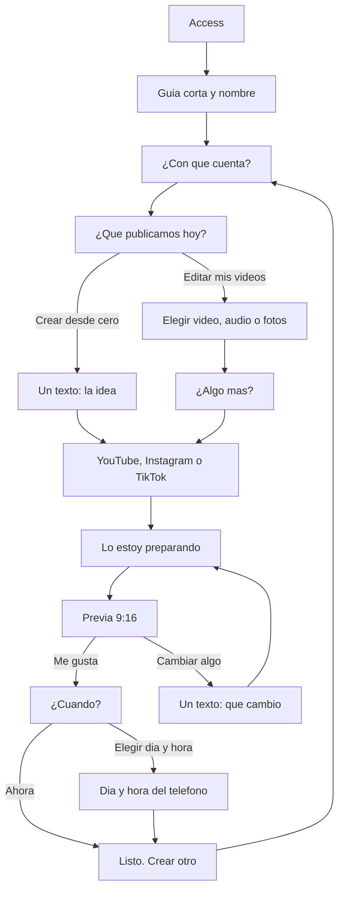
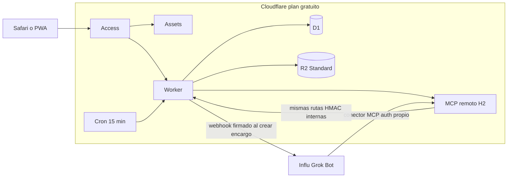

# Plan: UI de encargos (análisis, sin código de producto)

Fecha de las fuentes: 18 de noviembre de 2026. Base del repo: `main` en `db9109d` (incluye `AGENTS.md` y la skill de shadcn). Este documento no cambia el Worker, el bot ni el modo de publicación.

El producto sigue en **MOCK**. `LIVE_ENABLED_IN_BUILD` permanece en `false`. Nada de lo que se apruebe en la UI sale a YouTube, Instagram o TikTok.

El único coste aceptado es la suscripción de Grok que ya existe. Infraestructura, almacenamiento, alojamiento, autenticación, APIs de plataforma y librerías se quedan en planes gratuitos. R2 se usa dentro de su cupo gratuito de Standard; el alta, que pide un método de pago, la hace el usuario. El diseño rechaza operaciones antes de llegar a un importe.

## Resumen

La persona dueña de la cuenta sustituye al influencer virtual. Entra en una web de una sola columna, pensada para el móvil y usable con una mano. Cada pantalla hace una sola pregunta:

1. Guía corta la primera vez, el nombre, y «¿Con qué cuenta?» (un usuario de Access puede tener varias cuentas de creador).
2. «¿Qué publicamos hoy?» — Crear desde cero, o editar vídeo, audio, imágenes o texto.
3. «¿Dónde lo publicamos?» — YouTube, Instagram y TikTok, las tres con simulador MOCK en el MVP.
4. «Mira lo que he preparado» — previa vertical 9:16, y solo «¡Me gusta!» o «Cambiar algo».
5. «¡Listo!» — plataformas, racha en la zona horaria del teléfono y «Crear otro».

Publicar de inmediato o programar fecha y hora ocurre después de aprobar. La hora sale de la huella del lote (apartado de API).

La UI vive en el mismo Worker, como assets estáticos, detrás del Cloudflare Access que ya protege la API. El navegador no guarda secretos HMAC. El encargo se escribe en D1. Al crearlo, el Worker avisa al Grok Bot Influ por webhook (fase H2); el bot usa un conector MCP remoto en el mismo Worker y la herramienta nativa Grok Imagine para generar solo cuando hay trabajo reclamado. `bot/influ.mjs` queda para pruebas y CI sobre las mismas rutas HMAC. El Worker no llama a Grok Imagine ni expone claves de API de Grok.

El vídeo nuevo va a R2 Standard, con topes por usuario y globales por debajo del cupo gratuito. KV deja de usarse para ese vídeo. Lo que no quepa en el tope se rechaza.

Publica el Worker, en el cron que ya existe, nunca el bot. En MOCK no hay tokens de redes. El diseño futuro guarda solo un refresh token cifrado, por cuenta de creador, y cada publicación sigue exigiendo la aprobación de esa versión. El detalle está en «Quién publica y cómo».

## Decisiones cerradas

Quedan cerradas. El resto del documento ya las aplica.

1. Varias cuentas de creador por usuario de Access, con selector desde el primer uso. Aislamiento por el correo del JWT en cada endpoint.
2. Influ no sondea la cola: despierta con el webhook del Worker (H2). La revisión de respaldo es poco frecuente (por ejemplo diaria). Imagine solo corre con un encargo ya reclamado.
3. R2 Standard, con topes que no llegan al cupo gratuito. Sin Infrequent Access. El usuario completa el alta.
4. Subida directa hasta 5 MiB. A partir de ahí, partes de 5 MiB. Archivo máximo 150 MB. El origen se conserva para poder regenerar y se borra al cerrar o cancelar el encargo. La pieza descartada se borra en ese momento con `DeleteObject`.
5. Con la PWA instalada, el icono abre la web app. Sin instalar, se usa Safari. La prueba de Access dentro de la PWA del iPhone es obligatoria.
6. El MVP incluye simuladores MOCK de Instagram y TikTok, además de YouTube.
7. La zona horaria es la del teléfono.
8. El nombre se pide en una guía corta el primer día, queda ligado al usuario de Access y se puede cambiar.
9. La línea «Hecho con ayuda de IA» y `contains_synthetic_media` solo si el bot genera o altera. Un recorte del material propio va sin aviso y con el flag en false.
10. La parte mide 5 MiB. El Worker no calcula el SHA-256 (los 10 ms de CPU no dan margen). Lo calcula el teléfono, R2 lo comprueba al guardar con `put({ sha256 })`, el bot lo repite antes de generar y la aprobación queda atada a esa huella. El detalle está en «Integridad».

## Coste cero

| Pieza | Plan | Límite gratuito (fuente) | Al superarlo, y cómo no llegamos |
|---|---|---|---|
| Worker (API) | Workers Free | 100.000 peticiones/día; 10 ms de CPU por invocación HTTP y por cron; 128 MB de memoria; 50 subpeticiones externas y 1.000 a servicios de Cloudflare por invocación; 5 cron por cuenta. [Límites](https://developers.cloudflare.com/workers/platform/limits/), [precios](https://developers.cloudflare.com/workers/platform/pricing/), [subpeticiones](https://developers.cloudflare.com/changelog/post/2026-02-11-subrequests-limit/) | Error 1027 o 1102 hasta las 00:00 UTC. En Free no hay cargo: la petición falla. El sondeo es de JSON, cada 15 s, solo con la pantalla visible. |
| Assets de la UI | Incluidos en Workers | Peticiones a assets estáticos gratis y sin tope. Cada asset ≤ 25 MiB; 20.000 archivos por versión en Free. [Precios](https://developers.cloudflare.com/workers/platform/pricing/), [límites](https://developers.cloudflare.com/workers/platform/limits/) | HTML, JS e iconos de la PWA caben. |
| Cuerpo HTTP | Zona Free, Worker en un dominio propio | 100 MB por petición; por encima, HTTP 413. [Límites](https://developers.cloudflare.com/workers/platform/limits/) | Cada parte mide 5 MiB. No depende de los 100 MB ni de si `workers.dev` aplica esa tabla. |
| R2 | Standard, cupo mensual | 10 GB-mes, 1 millón de operaciones de clase A, 10 millones de clase B, salida a Internet gratis. El cupo gratuito no cubre Infrequent Access. [Precios](https://developers.cloudflare.com/r2/pricing/) | Lo que pase del cupo se factura. El alta exige completar la suscripción y un método de pago. [Primeros pasos](https://developers.cloudflare.com/r2/get-started/). Lo hace el usuario. El código se queda por debajo: ver «Topes de R2». |
| KV `influ-poc-media` | Incluido en Workers Free | 25 MiB por valor; 1 GB; 100.000 lecturas/día; 1.000 escrituras/día. [Límites](https://developers.cloudflare.com/kv/platform/limits/), [precios](https://developers.cloudflare.com/kv/platform/pricing/) | Sigue para lo ya guardado de la POC. El vídeo de la UI no se escribe aquí. |
| D1 | Workers Free | 5 millones de filas leídas/día; 100.000 escritas/día; 5 GB en la cuenta; 500 MB por base; 50 consultas por invocación; fila ≤ 2 MB. [Precios](https://developers.cloudflare.com/d1/platform/pricing/), [límites](https://developers.cloudflare.com/d1/platform/limits/), [aviso](https://developers.cloudflare.com/changelog/post/2026-09-01-d1-free-tier-limit-enforcement/) | Las consultas fallan hasta las 00:00 UTC. Los contadores de R2 van en filas diarias indexadas, no en un barrido. |
| Cron | 1 de 5 | `*/15` ya está en `wrangler.toml`. CPU de cron en Free: 10 ms. | No se añade un cron que llame a Grok. |
| Access | Zero Trust Free | 50 usuarios. El service token del bot no consume asiento. [Planes](https://www.cloudflare.com/plans/zero-trust-services/), [asientos](https://developers.cloudflare.com/cloudflare-one/team-and-resources/users/seat-management/) | El usuario 51 no entra. Esta cuenta ya tiene Access. |
| Workers Logs | Free, y Observability Free desde el 1 dic 2026 | 200.000 eventos/día hasta entonces. Después, 0,5 GB/día y la ingesta se detiene sin facturar. [Logs](https://developers.cloudflare.com/workers/observability/logs/workers-logs/), [Observability](https://developers.cloudflare.com/observability/pricing/) | Se dejan de guardar logs. El Worker sigue. |
| shadcn/ui, React, Tailwind | Código copiado al repo | Sin cuenta. `components.json` se crea en la fase de UI, dentro de `ui/`. Hasta entonces no existe, como dice `AGENTS.md`. | Nada que pagar. |
| PWA | El sistema | Manifiesto y «Añadir a pantalla de inicio». [Apple](https://support.apple.com/guide/iphone/open-as-web-app-iphea86e5236/ios) | Sin tienda y sin cuota. |
| Revisión de las apps de redes | Proceso de cada plataforma | YouTube: formulario de auditoría, sin precio en la página. [Auditoría](https://developers.google.com/youtube/v3/guides/quota_and_compliance_audits). Meta: App Review desde el panel, sin precio en la introducción. [App Review](https://developers.facebook.com/docs/resp-plat-initiatives/app-review/introduction/). TikTok: la revisión pide una demo gratuita para el revisor y no publica una tarifa. [Guía del desarrollador](https://developers.tiktok.com/doc/our-guidelines-developer-guidelines). | Fuera del MVP (sigue MOCK). No se contrata un trámite de pago. Si una página pasara a listar un precio, se para y se pregunta. |
| Grok / Grok Imagine | Suscripción que ya tienes | Generar sí, con encargo reclamado vía MCP (H2). Influ no sondea la cola. | El Worker no añade una clave de API de Grok. |

Cloudflare redondea al alza la unidad facturable: 1,1 GB-mes se facturan como 2 GB-mes, y 1.000.001 operaciones como 2 millones. [Precios de R2](https://developers.cloudflare.com/r2/pricing/). Por eso los topes dejan margen y no se apoyan en «usar justo 10 GB».

## Topes de R2

Solo Standard. Ninguna regla pasa objetos a Infrequent Access: esa clase no tiene cupo gratuito, cobra la lectura y un mínimo de 30 días aunque se borre antes. [Precios](https://developers.cloudflare.com/r2/pricing/).

Clase A (escriben o listan): `PutObject`, `CreateMultipartUpload`, `UploadPart`, `CompleteMultipartUpload`, `ListObjects`, `PutBucketLifecycleConfiguration`, entre otras. Clase B (leen): `GetObject`, `HeadObject`. Borrar es gratis: `DeleteObject`, `AbortMultipartUpload`. [Misma página](https://developers.cloudflare.com/r2/pricing/).

El GB-mes es la media de los picos diarios. Si en ningún momento hay más de 6 GB guardados, el GB-mes no pasa de 6, en cualquier ciclo de facturación. Las operaciones se cuentan en una ventana móvil de 30 días, no en el mes natural: el aniversario de facturación de la cuenta no está en el repo, y dos meses naturales pueden caer en la misma factura.

| Contador | Tope duro | Cupo oficial | Margen |
|---|---|---|---|
| Bytes guardados ahora, global | 6 GB | 10 GB-mes | Cabe el redondeo y objetos que el ciclo de vida aún no ha borrado (puede tardar unas 24 h). [Ciclo de vida](https://developers.cloudflare.com/r2/buckets/object-lifecycles/) |
| Clase A, 30 días, global | 800.000 | 1.000.000 | 1.000.001 ya se redondearía a 2 millones. |
| Clase B, 30 días, global | 8.000.000 | 10.000.000 | El mismo redondeo. |
| Bytes por usuario de Access | 300 MB a la vez | — | Varias cuentas de creador del mismo correo comparten este tope. |
| Clase A por usuario, 30 días | 10.000 | — | 50 usuarios al tope sumarían 500.000, por debajo de 800.000. |
| Clase B por usuario, 30 días | 100.000 | — | La previa y la lectura del bot caben. |

Antes de cada `put`, `head` o `get`, una transacción en D1 reserva la unidad (`UPDATE … WHERE usado + 1 <= tope`). Si no cabe, la API responde 413 y no llama a R2. Si R2 falla después de reservar, se descuenta. Un `put` rechazado por checksum puede contar igual como clase A: el caso documentado es un `Content-MD5` que no coincide (`BadDigest`). No se reintenta en bucle. No se usa `ListObjects`: el índice vive en D1, porque listar es clase A.

Retención. `DeleteObject` es gratis. [Precios](https://developers.cloudflare.com/r2/pricing/).

1. «Cambiar algo» o `CAMBIOS` borra en esa misma petición la pieza que se acaba de descartar y la versión anterior de esa pieza, si la había. El contador de bytes guardados baja por el tamaño de esas claves. El origen se queda: el bot lo vuelve a leer para regenerar.
2. Cerrar el encargo (`COMPLETED`, `FAILED` o `PARTIALLY_COMPLETED`) borra la pieza que quedaba y el origen, y libera esos bytes.
3. Cancelar el encargo borra en esa misma petición el origen y todas las versiones de la pieza. Libera todos los bytes de ese encargo.
4. La reserva que se libera es la de bytes guardados ahora. Las operaciones de clase A y de clase B de la ventana de 30 días siguen contadas: ya se hicieron.
5. El ciclo de vida, una sola vez y en Standard, sin transición de clase, solo recoge lo que esa petición no llegó a borrar: partes de una subida que nunca se enlazó, a 1 día. No caduca a los 2 ni a los 7 días un origen o una pieza que D1 todavía referencia, porque el origen hace falta mientras el encargo siga abierto y una pieza aprobada puede estar programada. El cron reintenta desde D1 los `DeleteObject` que fallaron. [Ciclo de vida](https://developers.cloudflare.com/r2/buckets/object-lifecycles/). `PutBucketLifecycleConfiguration` es una operación de clase A y se hace una vez.

Si el binding de R2 no está, la subida se rechaza. No hay caída silenciosa a un almacenamiento de pago ni a Infrequent Access.

## Flujo de UX

Una columna, la misma en el teléfono y en el escritorio. La acción principal está abajo, al menos a 44×44 pt. [Accesibilidad](https://developer.apple.com/design/human-interface-guidelines/accessibility), [controles](https://developer.apple.com/design/tips/), [zonas seguras](https://developer.apple.com/design/human-interface-guidelines/layout).

La guía y el nombre salen solo la primera vez. Después, Access lleva al selector de cuentas.

### Pantallas

**0. Entrar.** Cloudflare Access, a página completa. En Safari o, si el icono ya está instalado, dentro de la web app. La cookie de la web app es otra: hay que entrar otra vez desde el icono. [WWDC23](https://developer.apple.com/videos/play/wwdc2023/10120/).

**0b. Guía, solo el primer día.** Tres frases (eliges, miras, y si te gusta se deja programado; todavía es una simulación) y un botón «Empezar».

**0c. Nombre.** Un campo «¿Cómo te llamas?». Debajo, una línea con la zona horaria que reporta el teléfono (`Intl.DateTimeFormat().resolvedOptions().timeZone`), sin otro control. «Listo» crea el usuario de Access y la primera cuenta de creador con ese nombre. El nombre queda en `users.display_name`, ligado al correo del JWT. Se cambia después en una pantalla de un solo campo, «Cambiar nombre», abierta desde el selector.

**1. «¿Con qué cuenta?»** Un botón por cuenta de creador de ese correo, y «Nueva cuenta» (un campo con el nombre de esa cuenta). Aunque haya una sola, el selector está: es la puerta. La racha de la cuenta elegida va en una línea.

**2. «¿Qué publicamos hoy?»** «Crear desde cero» y «Editar mis vídeos». Línea pequeña: «Simulación: todavía no se publica de verdad».

**2a. Desde cero.** Un campo y «Prepararlo». Esto siempre es contenido generado: llevará aviso de IA.

**2b. Editar.** Un botón «Elegir vídeo, audio o fotos» (`<input type="file" accept="image/*,video/*,audio/*" multiple>` sin `capture`, para que iOS ofrezca cámara, galería y archivos). [Archivo](https://html.spec.whatwg.org/multipage/input.html#file-upload-state-(type=file)). La previa de lo elegido es local. «Seguir».

**2c. «¿Algo más?»** Un campo que puede ir vacío y «Prepararlo». Aquí cabe «solo quita el principio»: el bot, al devolver la pieza, marca si ha generado o alterado, o si ha sido un recorte.

**3. «¿Dónde lo publicamos?»** YouTube, Instagram y TikTok. Las tres tienen simulador en el MVP. Controles grandes y «Seguir».

**4. «Lo estoy preparando.»** Sin decisión. Se puede cerrar el teléfono. Influ se despierta con el webhook al crear el encargo.

**5. Previa 9:16.** `playsinline`, silencio hasta que se toca el vídeo. Abajo, «¡Me gusta!» y «Cambiar algo». La línea «Hecho con ayuda de IA» sale solo si el resultado viene marcado como generado o alterado.

**6. «¿Qué cambio?»** Un campo y «Volver a preparar». En esa petición se borra de R2 la pieza descartada y la versión anterior, y se liberan sus bytes. El origen sigue, para que el bot regenere. La aprobación anterior queda invalidada.

**7. «¿Cuándo?»** «Ahora» o «Elegir día y hora».

**8. Día y hora.** Control nativo, interpretado en la zona del teléfono, y «Programar».

**9. «¡Listo!»** Plataformas, hora, racha del día en esa zona, «Crear otro». Una línea, no un botón, explica Añadir a pantalla de inicio. Si ya está instalada, la línea no sale.

Desde el selector también se abre «Qué ha pasado»: una lista de las simulaciones de esa cuenta (plataforma, hora, id `MOCK-…`). Es la auditoría que ve la persona. No mezcla cuentas.

Un archivo por encima de 150 MB, o que no quepa en los 300 MB del usuario o en los 6 GB globales, se rechaza con una frase. No se ofrece un plan de pago.

## Móvil, subidas, Safari y PWA

### Tamaños

| Caso | Qué se hace | Operaciones R2 |
|---|---|---|
| Archivo ≤ 5 MiB | Un `put` con `sha256` | 1 de clase A |
| Archivo > 5 MiB y ≤ 150 MB | Una parte = un objeto `put` con `sha256`. 5 MiB, la última puede ser menor | 1 de clase A por parte |
| Más de 150 MB | Rechazo, sin llamar a R2 | 0 |

No se usa el multipart de R2. `uploadPart` no acepta un SHA-256 (sus opciones son metadatos, clase y SSE-C) y el ETag del objeto montado no es el hash del archivo. [API del Worker](https://developers.cloudflare.com/r2/api/workers/workers-api-reference/), [ETag](https://developers.cloudflare.com/r2/objects/upload-objects/). 150 MB son 30 objetos de 5 MiB: 30 operaciones de clase A, dentro de las 10.000 del usuario. El teléfono parte con `File.slice` y no carga el archivo entero. Si iOS mata la pestaña, se vuelve a elegir el mismo archivo y se saltan las partes ya guardadas. `localStorage` recuerda la sesión en ese origen. Una subida empezada en Safari no sigue dentro de la web app: el almacenamiento es otro.

### Integridad

El Worker no hashea el cuerpo. En el plan Free hay 10 ms de CPU por invocación. Esperar a la red no cuenta; calcular un SHA-256 sí. [CPU](https://developers.cloudflare.com/workers/platform/limits/). `crypto.DigestStream` hashea un stream sin guardarlo en memoria, y es más rápido que un hash escrito en JavaScript, pero el cómputo sigue siendo CPU. [Web Crypto](https://developers.cloudflare.com/workers/runtime-apis/web-crypto/). La propia doc de subir el límite de CPU pone como ejemplo hashear un archivo grande de R2 y pasarse del tiempo. [Límite de CPU](https://developers.cloudflare.com/changelog/post/2025-03-25-higher-cpu-limits/). No hay una medida en este repo que meta 5 MiB en 10 ms. Por eso el hash no se hace en el Worker.

| Opción | Qué garantiza | Qué no garantiza |
|---|---|---|
| `put({ sha256 })` de R2 | R2 rechaza el objeto si los bytes no coinciden con el SHA-256 que se le pasa. El checksum queda guardado y se lee en `head`/`get`. El MD5 también viene por defecto en objetos que no son multipart. [API del Worker](https://developers.cloudflare.com/r2/api/workers/workers-api-reference/) | Alguien tiene que calcular ese SHA-256 fuera del Worker. Un `PutObject` con `Content-MD5` que no coincide responde 400 `BadDigest` y aun así cuenta como clase A. [Precios, preguntas](https://developers.cloudflare.com/r2/pricing/) |
| `Content-MD5` en `PutObject` y en `UploadPart` | R2 comprueba el MD5 del cuerpo. Está en la API S3 de ambos. [Compatibilidad S3](https://developers.cloudflare.com/r2/api/s3/api/) | El dominio ya identifica el archivo por SHA-256, no por MD5. MD5 no resiste una colisión buscada. No sustituye a la huella del lote. |
| `x-amz-checksum-sha256` | SHA-256 existe como checksum **compuesto**, no de objeto completo. El único de objeto completo es CRC-64/NVME. [Tipos de checksum](https://developers.cloudflare.com/r2/api/s3/api/) | Un SHA-256 compuesto no es el SHA-256 del archivo. Usarlo como huella sería falso. |
| ETag de multipart | El ETag de cada parte es el MD5 de esa parte. El del objeto cerrado es el MD5 de la concatenación de esos MD5, más `-<número de partes>`. [Subida](https://developers.cloudflare.com/r2/objects/upload-objects/) | No es el SHA-256 del archivo ni sirve para la huella que la persona aprueba. |
| Hash en el teléfono | `crypto.subtle.digest('SHA-256', …)` en un contexto HTTPS, sin coste y sin el tope de 10 ms. Cada parte de 5 MiB cabe en el teléfono. | Solo, no impide que el Worker guarde otros bytes: hay que entregarle el hash a R2. |
| El bot recalcula al leer | Antes de Imagine, fuera del tope de CPU del Worker. Si no coincide, el encargo pasa a `failed` y no hay previa ni aprobación. | Llega tarde para ser la única barrera: los bytes ya estarían en R2, y un olvido del bot los dejaría pasar. |

Recomendación, las cuatro comprobaciones a la vez:

1. El teléfono calcula el SHA-256 de cada parte y el del archivo entero, leyendo el `File` por cortes para no tener 150 MB en memoria.
2. El Worker reenvía ese hash en `put(clave, cuerpo, { sha256, storageClass: 'Standard' })` y no lo recalcula. R2 guarda el objeto solo si los bytes coinciden. D1 anota el `checksums.sha256` que devuelve R2, no el número que dijo el teléfono si R2 no lo ha aceptado.
3. El bot, al reclamar, hace `head` de cada parte (clase B) y compara con D1. Luego lee los bytes, los junta, recalcula el SHA-256 del archivo y lo compara con el que anunció el teléfono. Si algo no cuadra, `failed`. Ese SHA-256 del archivo es el `media.sha256` de la huella que la persona aprueba.
4. Al despachar, también en MOCK, el Worker vuelve a hacer `head` y compara `checksums.sha256` con las partes selladas en la versión aprobada. No hashea. Si el objeto de R2 ya no es el aprobado, no se publica.

Sustituir el cuerpo a mitad de camino falla en el `put`. Sustituirlo después, en el `head` del bot o en el del cron. La persona aprueba la huella de esos bytes, como ya exige WF-02 con versión y `content_hash`. Una versión nueva cambia la huella e invalida la aprobación.

El audio entra como origen (`audio/*`). El texto de la nota vive en D1.

No hay ffmpeg en el teléfono.

### iOS Safari y la PWA

UI y API en el mismo origen, para que `CF_Authorization` sea de primera parte. `fetch` con `credentials: "same-origin"`. [Cookie](https://developers.cloudflare.com/cloudflare-one/access-controls/applications/http-apps/authorization-cookie/), [sesión](https://developers.cloudflare.com/cloudflare-one/troubleshooting/access/).

- Sin instalar: se usa Safari.
- Instalada: el manifiesto pide `display: "standalone"`, y el icono abre la web app. [WebKit](https://webkit.org/blog/13878/web-push-for-web-apps-on-ios-and-ipados/), [guía de Apple](https://support.apple.com/guide/iphone/open-as-web-app-iphea86e5236/ios).
- La prueba de la fase J entra desde el icono, completa Access dentro de la web app y llega a la guía o al selector. Las cookies no se comparten con Safari, y el login salta a otro host (`cloudflareaccess.com`). Si esa vuelta se abre en Safari y la web app se queda fuera, es un fallo de esa fase, a corregir con la navegación en la misma ventana. No se cambia el manifiesto a un marcador.
- Sin service worker en el MVP: no hace falta para el icono y puede tragarse un `PUT`.
- Identidad: `payload.email` del JWT que el Worker ya verifica. [Validar JWT](https://developers.cloudflare.com/cloudflare-one/identity/authorization-cookie/validating-json/).
- Las rutas de la UI no caen en el cubo anónimo de 60/min. Hoy cualquier petición sin HMAC entra ahí (`applyHttpRateLimit`). Las de la persona usan un cubo por correo.

La zona horaria se lee en cada entrada y se guarda en el usuario. La racha y las horas nuevas usan esa zona. Si el teléfono cambia de zona, se actualiza.

## Arquitectura

| Paso | Dónde | Qué ocurre |
|---|---|---|
| Alojo | Assets del mismo Worker | Un origen, una aplicación Access. |
| Cuentas | D1, filtradas por el correo del JWT | El selector solo lista las de ese correo. |
| Encargo | `POST` con el JWT | `queued`, con `account_id`. |
| Influ lo procesa | Webhook H2 y conector MCP | Al `POST /v1/me/encargos`, el Worker llama al webhook de la rutina Influ (secreto del Worker, petición firmada). Influ reclama vía MCP, genera con Grok Imagine y sube el resultado. Si el webhook falla, el encargo sigue en cola. `bot/influ.mjs` reproduce el flujo en pruebas y CI. |
| Previa | `GET` de la pieza en R2 | Cuenta como clase B y solo si el SHA es de una cuenta de ese correo. |
| Aprobar | JWT del dueño | Versión y huella, como WF-02. |
| Publicar | Cron del Worker, MOCK | YouTube, Instagram o TikTok simulados. El bot no publica. |

`AGENTS.md` dice que no hay UI y que no se cree `components.json` salvo para meter shadcn. La fase de UI es ese momento.

Stack de la UI: Vite + React en `ui/`, Tailwind y shadcn (`Button`, `Field`, `Textarea`, `ToggleGroup`, `Progress`, `Skeleton`). Prueba visual con Vite. `wrangler dev --local` no arranca (`SERVICE_VERSION`). El rediseño visual es la fase I. El iPhone real es la fase J.

## Modelo de datos y API

Migración `migrations/0004_encargos.sql`. No se reescriben `0001`–`0003`.

| Tabla | Para qué |
|---|---|
| `users` | `email` único del JWT, `display_name`, `time_zone`, `guide_seen_at`. |
| `accounts` | Cuenta de creador. `user_id`, `name`. Varias por usuario. |
| `encargos` | `account_id`, `kind` (`from_scratch` \| `edit`), nota, estado, plataformas, `batch_id`, `publish_at` después de aprobar, `synthetic` (lo fija el bot al devolver). |
| `encargo_assets` | `role` (`source` \| `deliverable`), clave R2, sha256, mime, tamaño, versión. Al borrar en R2 se quita la fila y bajan los bytes. |
| `upload_sessions` | Dueño (`user_id`), partes esperadas y recibidas, SHA-256 de cada parte y del archivo. El de la parte es el `checksums.sha256` que devolvió R2. |
| `streaks` | Por cuenta. El día civil es el de `users.time_zone`. |
| `r2_daily` | Por día UTC, global y por `user_id`: clase A, clase B, y el pico de bytes. La reserva mira la suma de 30 días y los bytes actuales. |
| `platform_connections` | Vacía en el MVP. Reservada para el refresh token cifrado del diseño futuro. `account_id` obligatorio. |

`batches.account_id` en cada lote nuevo. Índices por `account_id` y por `user_id`.

`persona` del lote es el nombre de la cuenta de creador. `contains_synthetic_media` copia `encargos.synthetic`. Desde cero, el bot lo pone a true. En edición, true solo si ha generado o alterado; un recorte del material propio va a false y la previa no muestra la línea de IA.

La huella (`hashableContent`) deja fuera `scheduled_at`. La hora se escribe, ya aprobado el lote, sin nueva versión y con evento de auditoría. Cambiar archivo o texto sí invalida la aprobación. Hay que actualizar las pruebas de dominio.

### API de la persona

JWT de Access. Cada ruta resuelve el recurso con `users.email = claim`. Si el id no es de ese correo, 404.

| Método y ruta | Uso |
|---|---|
| `GET /v1/me` | Usuario, zona, si falta la guía, cuentas. |
| `POST /v1/me` | Cierra la guía: nombre y zona. |
| `PATCH /v1/me` | Cambia el nombre. |
| `POST /v1/me/accounts` | Nueva cuenta de creador. |
| `PATCH /v1/me/accounts/:id` | Cambia el nombre de esa cuenta. |
| `POST /v1/me/encargos` | Crea el encargo en una cuenta propia. |
| `POST /v1/me/uploads` | Abre sesión si el tamaño ≤ 150 MB y los topes de R2 dan. |
| `PUT /v1/me/uploads/:id/parts/:n` | Una parte de como mucho 5 MiB. El cuerpo va a R2 con el SHA-256 que mandó el teléfono. |
| `POST /v1/me/uploads/:id/complete` | Marca la sesión completa y enlaza el origen. No llama a R2. |
| `GET /v1/me/encargos/:id` | Estado, para el sondeo. |
| `GET /v1/me/media/:sha256` | Previa. 404 si el SHA no es de una cuenta de ese correo. |
| `POST /v1/me/encargos/:id/decision` | `approve` o `changes`, con versión y huella. `changes` borra en R2 la pieza descartada y la versión anterior, y libera sus bytes. El origen sigue. |
| `POST /v1/me/encargos/:id/cancel` | Borra en R2 el origen y todas las versiones, y libera sus bytes. |
| `POST /v1/me/encargos/:id/schedule` | `now` o una hora, solo aprobado. |
| `GET /v1/me/accounts/:id/streak` | Racha. |
| `GET /v1/me/accounts/:id/activity` | Auditoría visible: simulaciones de esa cuenta. |

No hay ruta para leer o escribir una cuenta pasando el correo de otro usuario, ni un id «en crudo» sin el join del JWT.

### API del bot

HMAC `bot`. El bot no recibe refresh tokens ni el listado de cuentas.

| Método y ruta | Uso |
|---|---|
| `GET /v1/encargos?status=queued` | La cola. Cada ítem es un encargo, con sus claves R2, no las de otros. |
| `POST /v1/encargos/:id/claim` | Reserva. |
| `POST /v1/encargos/:id/result` | Ata el lote y `synthetic`. El bot ya ha comparado el `head` de R2 y ha recalculado el SHA-256 del archivo. |

En producción (H2), Influ opera con el conector MCP del Worker, no con `bot/influ.mjs`. La generación la hace Influ con su herramienta Grok Imagine; `INFLU_GROK_GENERATE_COMMAND` deja de ser el camino principal (solo respaldo local en el CLI para CI).

### MCP del bot (fase H2)

Servidor MCP remoto en el mismo Worker ([Cloudflare Agents SDK](https://developers.cloudflare.com/agents/)), encima de las rutas de «API del bot». El Grok Bot Influ lo registra como conector personalizado.

| Herramienta MCP | Equivale a |
|---|---|
| Reclamar encargo | `POST /v1/encargos/:id/claim` |
| Leer origen del encargo | Lectura de assets R2 del encargo reclamado |
| Subir pieza o resultado | `POST /v1/encargos/:id/result` |
| Revisar estado | Consulta de estado del encargo (y cola si hace falta en la revisión de respaldo) |

No hay herramienta de aprobar: la aprobación sigue siendo solo de la persona, por la UI con su JWT de Access.

Autenticación del MCP, en dos capas (H3): el JWT de una aplicación Access que cubre solo `/mcp` (service token dedicado, `aud` propio y `common_name` igual a su Client ID) y el bearer `MCP_BEARER_TOKEN`. Las dos son obligatorias. No hay Bypass. Un JWT de persona de la UI no abre `/mcp`. Los secretos viven solo en el Worker (`wrangler secret put`). El teléfono y el navegador no reciben credenciales del conector.

### Webhook hacia Influ (fase H2)

Al crear un encargo (`POST /v1/me/encargos`), el Worker hace una subpetición `fetch` al webhook de la rutina de Influ. La URL es un secreto del Worker; la llamada va firmada o con secreto compartido. Así Influ solo despierta cuando hay trabajo nuevo.

Un fallo del webhook no bloquea el encargo: queda en cola en D1. Influ lleva una revisión de respaldo poco frecuente (por ejemplo diaria) por si se pierde un aviso.

`POST /v1/batches` sigue rechazando `mode`, `live` y `approved*`. El cron no aprueba.

## Aislamiento

1. Access deja pasar a quien cumple la política.
2. El Worker verifica el JWT y toma `email`.
3. `users.email` es la única clave de propiedad. Las cuentas, encargos, sesiones, piezas y (en el futuro) conexiones cuelgan de ese usuario por clave ajena.
4. Todo `SELECT`/`UPDATE`/`DELETE` de la UI incluye ese `user_id`. Probar el id de otro correo devuelve 404.
5. Conectar una red, el día que exista, exige el OAuth de esa red hecho por quien está en esta sesión de Access. El token se guarda en una cuenta de ese correo. No hay enlace para «prestar» una cuenta, ni un endpoint que acepte un `account_id` ajeno. Quien tenga las credenciales de la red puede repetir el OAuth en su propio usuario; eso no le deja ver los encargos del otro.
6. El bot HMAC y el MCP no son usuarios. Ven un encargo reclamado y sus objetos, y queda en `audit_log` con el `account_id`. No listan usuarios ni leen `platform_connections`. El MCP no expone aprobar ni rutas de la persona.
7. El cron carga la publicación por su id interno. No acepta un correo ni un account id venidos de fuera.

Pruebas de aceptación: dos correos; el segundo pide el encargo, la pieza, la racha, la actividad y la conexión del primero y recibe 404 en todas. Un service token no abre `/v1/me`.

## Quién publica y cómo

Publica el Worker (WF-04, disparado por el cron o por «Ahora»). El bot no publica.

El bot es uno para todas las personas y su trabajo es generar, dentro de la suscripción de Grok. Si además guardara los tokens de todas las redes, un fallo del generador enseñaría todas las cuentas, y la generación y la publicación quedarían en el mismo sitio. El cron, el puerto `SocialPublisher`, la guardia de salida y el modo MOCK ya viven en el Worker. MOCK no necesita tokens: los adaptadores devuelven ids `MOCK-…` sin salir a Internet.

### Comparación

Las tres plataformas autentican la publicación con OAuth. Ninguna documenta un modo de «publicar más tarde sin ningún token en el servidor». Programar con la persona ausente exige un token vigente guardado. No guardar nada obliga a tener a la persona delante en el momento de publicar, y eso anula la programación.

| | Guardar el refresh token, cifrado, ámbitos mínimos | No guardar tokens: OAuth en cada publicación | Que publique el bot, con los tokens |
|---|---|---|---|
| Programar sin la persona delante | Sí. YouTube renueva el access token con el refresh. [OAuth](https://developers.google.com/identity/protocols/oauth2). Instagram renueva el token largo de 60 días. [Business Login](https://developers.facebook.com/documentation/instagram-platform/instagram-api-with-instagram-login/business-login). TikTok: access 24 h, refresh 365 días. [Tokens](https://developers.tiktok.com/doc/oauth-user-access-token-management). | No. Hay que repetir el consentimiento cuando toca publicar. | Sí, pero el bot compartido tendría los tokens de todos. |
| Contraseñas de la red | No se piden ni se guardan. | Tampoco. | Tampoco, pero el token queda en el generador. |
| Qué se guarda | Solo el refresh (o el token largo de Instagram), cifrado. El access token se pide al publicar y no se conserva pasado su vencimiento. | Nada entre publicaciones. | Lo mismo, en un proceso que también genera y ve el material de todos. |
| Ámbitos | YouTube: `youtube.upload` para subir; `videos.update` y `videos.list` pueden pedir `youtube`. Se pide el mínimo el día de LIVE. [videos.insert](https://developers.google.com/youtube/data/reference/rest/v3/videos/insert). Instagram: `instagram_business_basic` + `instagram_business_content_publish`. [Content Publishing](https://developers.facebook.com/docs/instagram-platform/content-publishing/). TikTok: `video.publish`. [Primeros pasos](https://developers.tiktok.com/doc/content-posting-api-get-started). | Los mismos, concedidos cada vez. | Los mismos, con peor custodia. |
| Revocación | En la app, «Desconectar» borra el cifrado. En la plataforma, el usuario revoca y el siguiente refresh falla: YouTube lo lista entre las causas de caducidad. [OAuth](https://developers.google.com/identity/protocols/oauth2). Instagram, si no se renueva en 60 días, muere. TikTok devuelve error de refresh y hay que entrar otra vez. La UI dice «hay que volver a conectar» y no reintenta en silencio. | Cada publicación es un consentimiento nuevo. Desconectar es no volver a entrar. | Hay que borrar el token en el bot y en la plataforma. Dos sitios. |
| Secretos de la app (client secret) | Un secret del Worker por plataforma, no por usuario. No está en git, ni en el teléfono, ni en el bot. YouTube: el canje es de servidor. [Web de servidor](https://developers.google.com/youtube/v3/guides/auth/server-side-web-apps). Instagram: el secreto no sale del servidor. [Canje](https://developers.facebook.com/documentation/instagram-platform/reference/access_token). TikTok: `client_secret` en el canje de servidor. [Tokens](https://developers.tiktok.com/doc/oauth-user-access-token-management). | Igual: el secreto sigue en el Worker, porque el canje no puede hacerse en el teléfono. | El bot necesitaría el client secret. Más copias. |
| Auditoría que ve la persona | Cada intento ya puede ir a `publication_events`. La pantalla «Qué ha pasado» lista plataforma, hora e id de su cuenta. El token autoriza al cron; la publicación concreta solo sale si esa versión está aprobada (huella). TikTok pide consentimiento expreso antes de enviar el archivo. [Directrices](https://developers.tiktok.com/doc/content-sharing-guidelines). Ese consentimiento es «¡Me gusta!» más la hora, sobre esa versión. | La persona ve el consentimiento de la plataforma cada vez. No hay rastro de una publicación hecha más tarde, porque no existe. | El rastro quedaría repartido entre bot y Worker. |
| Aislamiento | La fila cuelga de `account_id` y esa cuenta del correo del JWT. El cron no acepta un id de fuera. | Igual en el momento del OAuth. | El bot vería tokens de otros correos. Rompe el aislamiento. |
| Coste | El flujo OAuth y los formularios de revisión no publican un precio (fuentes de la tabla de coste). YouTube en Testing: refresh de 7 días y 100 usuarios de prueba, hasta verificar. [Estado de la app](https://developers.google.com/identity/protocols/oauth2/production-readiness/overview). Meta, para servir a varios negocios: Advanced Access y App Review. [App Review de Instagram](https://developers.facebook.com/documentation/instagram-platform/app-review). TikTok sin auditar: solo privado, 5 usuarios / 24 h. [Directrices](https://developers.tiktok.com/doc/content-sharing-guidelines). | El mismo coste de revisión el día que se salga de MOCK. Mientras tanto, alguien tiene que estar delante. | Igual, con peor frontera. |

Recomendación: el Worker publica; el bot no. No se guardan contraseñas. Para poder programar, se guarda el refresh token (en Instagram, el token largo) cifrado con AES-GCM; la clave es un secret del Worker. El access token solo vive en la invocación que publica. Los secretos de cada app son secrets del Worker, uno por plataforma. La persona desconecta en la UI y puede revocar en la red. Ve el historial de su cuenta y nada más. Esto no se construye en el MVP: las filas `platform_connections` nacen vacías y los adaptadores siguen en MOCK.

Límites que ya están escritos y no cambian con esta elección: YouTube, 100 `videos.insert` al día en el cupo por defecto. [Calculadora](https://developers.google.com/youtube/v3/determine_quota_cost). Instagram, la misma página dice 100 publicaciones API en 24 h y, en carruseles, 50; al implementar se consulta `content_publishing_limit`. TikTok, unas 15 por creador y día en la guía, y 6 init por minuto y token. [Direct Post](https://developers.tiktok.com/doc/content-posting-api-reference-direct-post). Instagram, en LIVE, no debe depender de una URL pública: la subida reanudable a `rupload.facebook.com` está documentada para Facebook Login for Business. [Content Publishing](https://developers.facebook.com/docs/instagram-platform/content-publishing/). TikTok usa `FILE_UPLOAD`, no `PULL_FROM_URL`.

## Seguridad

- El teléfono no recibe secretos HMAC, client secrets ni tokens de redes.
- El bot no recibe tokens de redes ni lista usuarios.
- Access y la comprobación del JWT siguen. El cron no aprueba.
- 404 entre correos, en cada endpoint, con prueba de dos usuarios.
- R2: reserva en D1 antes de la llamada; Standard; sin listar el bucket.
- Hash: lo calcula el teléfono, lo comprueba R2 en el `put`, lo repite el bot y el cron lo contrasta con `head` antes de publicar. El Worker no lo calcula y ata la sesión al `user_id`.
- Nonce anti-replay en las rutas HMAC. El endpoint MCP exige las dos capas de H3 (JWT de Access del conector y bearer); no es anónimo.
- Webhook de Influ: URL y material de firma solo como secretos del Worker; un fallo de entrega no cancela el encargo.
- La UI no puede enviar `mode`, `live` ni `publisher_mode`. El guard de CI sigue exigiendo MOCK.
- `localStorage` solo guarda el id de la subida a medias, en ese origen.

## Plan de implementación por fases

Este documento es la fase 0. Cada fase siguiente va en su PR, con pruebas. Un solo agente a la vez en `src/worker.js`, `src/core/domain/hash.js`, `src/adapters/repository/d1-repository.js` y `src/adapters/publishers/registry.js`.

| Fase | Qué entrega | Archivos | En paralelo con |
|---|---|---|---|
| 0 | Este plan | `docs/plan-ui-encargos.md` | — |
| A | Usuarios, varias cuentas, encargos, 404 por correo, rate limit por persona, actividad y racha en la zona guardada. Sin UI. | `migrations/0004_encargos.sql`, repositorio D1, workflows de encargos, `src/worker.js`, `tests/` | B, C y D |
| B | UI mobile-first, guía, nombre editable, selector, tres plataformas, aviso de IA según `synthetic`. API fingida. `components.json` dentro de `ui/`. Actualizar `AGENTS.md`. | `ui/**`, `AGENTS.md` | A, C, D |
| C | Simuladores MOCK de Instagram y TikTok, sin red. Obligatorios para el MVP. | `src/adapters/publishers/instagram/**`, `tiktok/**`, `registry.js`, `tests/unit/` | A, B, D |
| D | POC del CLI: cola HMAC, reclamar y devolver `synthetic` (sustituido en producción por H2). | `bot/**` | A, B, C |
| E | Hora fuera de la huella y programación. | `hash.js`, `wf02`, `wf03`, pruebas de dominio | Después de A |
| F | R2 Standard: cada parte un `put` con `sha256` comprobado por R2, tope 150 MB, contadores de 30 días, borrado inmediato y ciclo de vida solo para huérfanos, sin Infrequent Access. El usuario ha completado el alta antes de desplegar el binding. | Adaptador R2, `src/worker.js`, pruebas de tope, checksum y borrado | Después de A. No a la vez que E |
| G | Hecha. UI real en los assets del Worker, manifiesto PWA (sin service worker) y CI de la UI. [PR 24](https://github.com/daniel-saezv/Influ-orchestrator/pull/24), fusionada en `886b8c7`. | `ui/**`, `wrangler.toml` | Después de A, B, C y F |
| H | Rutas HMAC del bot («API del bot»): `GET /v1/encargos?status=queued`, `POST /v1/encargos/:id/claim` y `POST /v1/encargos/:id/result`. HMAC `bot`, integridad R2, `synthetic`, `audit_log`. `bot/influ.mjs` como herramienta de pruebas y CI sobre esas rutas (cola vacía sin Imagine). Solo backend. | `src/worker.js`, `bot/influ.mjs`, `tests/` | Después de A y F. En paralelo con I y H2 |
| H2 | MCP remoto (Agents SDK) sobre las mismas rutas; herramientas reclamar, leer origen, subir resultado y revisar estado; sin aprobar. Auth propia del conector. Webhook al crear encargo hacia la rutina Influ (secreto del Worker, fallo no bloquea cola); revisión de respaldo poco frecuente. Influ genera con Grok Imagine; `INFLU_GROK_GENERATE_COMMAND` deja de ser el camino principal. | `src/worker.js`, Agents SDK, secretos webhook/MCP, `tests/` | Después de H. En paralelo con I |
| H3 | Hecha. `/mcp` exige el JWT de una aplicación Access solo de esa ruta (`ACCESS_MCP_AUD` y `common_name` = `MCP_SERVICE_TOKEN_CLIENT_ID`) y el bearer. Sin Bypass. En producción, el resto de rutas responde 503 si faltan `ACCESS_TEAM_DOMAIN` o `ACCESS_AUD`. | `src/adapters/http/access-jwt.js`, `src/worker.js`, `wrangler.toml`, `tests/`, `docs/mcp-grok.md`, `docs/seguridad-api.md` | Después de H2 |
| I | Diseño visual de la UI. Identidad propia (paleta, acento, modo oscuro, tipografía, fondos con profundidad), animaciones con `prefers-reduced-motion`, componentes shadcn vía MCP de shadcn y `.agents/skills/shadcn`. Sin backend. Pruebas UI en verde; el usuario valida en la preview de la PR. | `ui/**` | Después de G. En paralelo con H y H2 |
| J | iPhone: Safari, icono, Access dentro de la PWA, cámara, galería, audio, reanudación, previa 9:16, selector de cuentas. | Ajustes de `ui/` si la prueba lo pide | Después de I (y de H2 para flujo real con webhook) |
| K | Service worker de la PWA: caché del shell y de los datos para usarla sin red o con mala cobertura, y notificaciones push en iPhone (hace falta la app en la pantalla de inicio). Pendiente, opcional y aplazable. | `ui/**` | Después de J. Se puede ir atrasando indefinidamente. |

OAuth, tokens y adaptadores LIVE no están en estas fases. La tabla `platform_connections` se crea vacía en A para no migrar dos veces.

La fase F prueba, además del tope y del checksum: `changes` borra la pieza descartada y la versión anterior, baja los bytes y deja el origen, de modo que una segunda generación lo vuelve a leer; cancelar borra origen y versiones y deja los bytes a cero para ese encargo; cerrar en `COMPLETED`, `FAILED` o `PARTIALLY_COMPLETED` borra la pieza que quedaba y el origen. Las operaciones de clase A y B de la ventana no bajan. Un `DeleteObject` que falla deja la fila y los bytes, y el cron lo reintenta.

La fase G está hecha. La [PR 24](https://github.com/daniel-saezv/Influ-orchestrator/pull/24) se fusionó en `886b8c7`: la UI real se sirve como assets del Worker, con el manifiesto PWA y sin service worker, y la CI construye y valida `ui/`.

La fase H implementa en el Worker la API de «API del bot», con HMAC `bot`, integridad en `result`, `synthetic` y `audit_log`, con pruebas unitarias y de aceptación. `bot/influ.mjs` queda como herramienta de pruebas y de CI sobre esas rutas (no es el camino de producción tras H2). Puede ir en paralelo con I y con la preparación de H2.

La fase H2 añade el servidor MCP remoto (Agents SDK) y el webhook al crear encargo, según las subsecciones «MCP del bot» y «Webhook hacia Influ». Influ conecta el Worker como conector personalizado, usa las herramientas MCP en lugar del script y genera con Grok Imagine integrado en Grok. La revisión de respaldo cubre avisos perdidos. Todo sigue en MOCK.

La fase H3 sustituye el Bypass de `/mcp` por una aplicación Access solo de esa ruta, con un service token distinto del CLI. El Worker exige el JWT de ese audience y el `common_name` del Client ID, además del bearer. Si falta esa config, `/mcp` responde 503 y no ejecuta herramientas. En producción, faltar `ACCESS_TEAM_DOMAIN` o `ACCESS_AUD` también cierra el resto de rutas; las previews siguen con sus vars de Access y las pruebas de Node, sin `ACCESS_JWT_REQUIRED`, no cambian. Sigue MOCK.

La fase I cambia el aspecto de la UI que entregó G: minimalista, con identidad propia y animaciones que respetan `prefers-reduced-motion`. Solo `ui/`. Puede ir en paralelo con H y H2. Criterio de aceptación: el usuario valida el aspecto en la preview de la PR antes de fusionar.

La fase J valida en iPhone el flujo completo, incluido el despertar de Influ vía webhook tras H2.

La fase K es la última y queda pendiente: es opcional y se puede ir atrasando indefinidamente. Añade un service worker a la PWA para dos cosas: usar la interfaz sin conexión o con mala red, guardando en caché el shell de la UI y los datos; y enviar notificaciones push en iPhone (hace falta tener la PWA instalada en la pantalla de inicio y un service worker), por ejemplo avisos de encargos. El riesgo a tratar es servir versiones antiguas de la UI desde la caché, así que hace falta una estrategia de versionado y actualización. Por eso se dejó fuera del MVP y de la fase G.

Pruebas de código, cuando existan: `npm run test:unit`, `npm run test:acceptance -- --target local`, `npm run deploy:guard`. Este PR no tiene UI que abrir.

## Pendiente: control de costes de R2

Tarea abierta. No forma parte de lo que se está construyendo ahora.

Cloudflare no ofrece hoy límites de gasto que bloqueen R2. Los límites que cortan el servicio al llegar a un importe solo existen para Workers y Durable Objects. Para R2 solo hay alertas de presupuesto por email, y no bloquean ni el uso ni el cargo.

El tope tiene que estar en la aplicación: una cuota total de almacenamiento, y si hace falta también de operaciones, por debajo de la cuota gratuita de R2. Una subida que la supere se rechaza y no llama a R2. Esa cuota se suma al límite de 150 MiB por archivo y a la limpieza de huérfanos que hace el cron.

El usuario configura una alerta de presupuesto en Cloudflare: Billing → Billable Usage → Set Budget Alert.

En cuanto Cloudflare permita límites de gasto nativos para R2, hay que revisar si cubren este caso.

## Riesgos

1. **R2 factura si alguien se salta el tope.** El redondeo convierte un GB o una operación de más en la unidad siguiente. La reserva en D1 es la barrera; el ciclo de vida solo recoge huérfanos y puede tardar unas 24 h. El alta lleva método de pago: lo pone el usuario, y un fallo del contador sí podría generar importe. Por eso el tope global es 6 GB y 800.000 operaciones de clase A, no el cupo oficial entero.
2. **CPU de 10 ms.** Hashear 5 MiB en el Worker, aunque sea con `DigestStream`, puede devolver 1102. El hash lo calculan el teléfono y el bot; R2 solo compara el que se le pasa. Si el mero paso del cuerpo a R2 también se pasa de 10 ms, se baja el tamaño de la parte: al no usar multipart, 5 MiB ya no es un mínimo de R2.
3. **Un generador para todos.** La cola es una. Dos encargos esperan turno. La pantalla lo dice. No se contrata otro bot.
4. **Webhook y MCP dentro del cupo del Worker.** El aviso a Influ y las herramientas MCP son subpeticiones del Worker. Imagine solo corre en Grok, con encargo reclamado. Si despertar la rutina de Influ pasara a cobrarse fuera de la suscripción, hay que parar: no entra en este plan.
5. **Access, 50 asientos.** El 51 no entra.
6. **La PWA no comparte cookies con Safari.** La fase J tiene que demostrar el login de Access desde el icono. Si el salto a `cloudflareaccess.com` abre Safari, se corrige ahí.
7. **iOS mata la subida.** Hay que volver a elegir el mismo archivo. El texto de la pantalla lo dice.
8. **LIVE sigue bloqueado.** Los simuladores no abren red. La revisión de YouTube, Meta y TikTok no publica un precio, pero puede rechazar la app o dejar TikTok en privado y YouTube con tokens de 7 días mientras la app esté en Testing. Eso es posterior al MVP.
9. **Instagram y una URL pública.** El diseño futuro usa la subida reanudable documentada para Facebook Login for Business, no una URL abierta del bucket. Hasta entonces no hay publicación real.
10. **D1 y peticiones del Worker.** Sondeo como mucho cada 15 s y con la pestaña visible. Consultas de contadores por índice.
11. **`wrangler dev` no arranca.** La UI se prueba con Vite.
12. **Logs.** Desde el 1 de diciembre de 2026 el exceso en Free deja de ingerirse, sin factura. La UI no escribe cuerpos ni tokens en el log.
